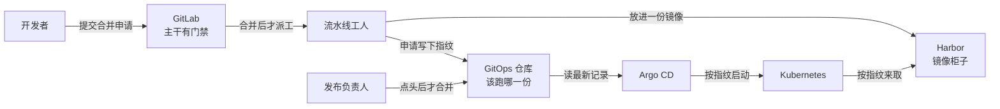
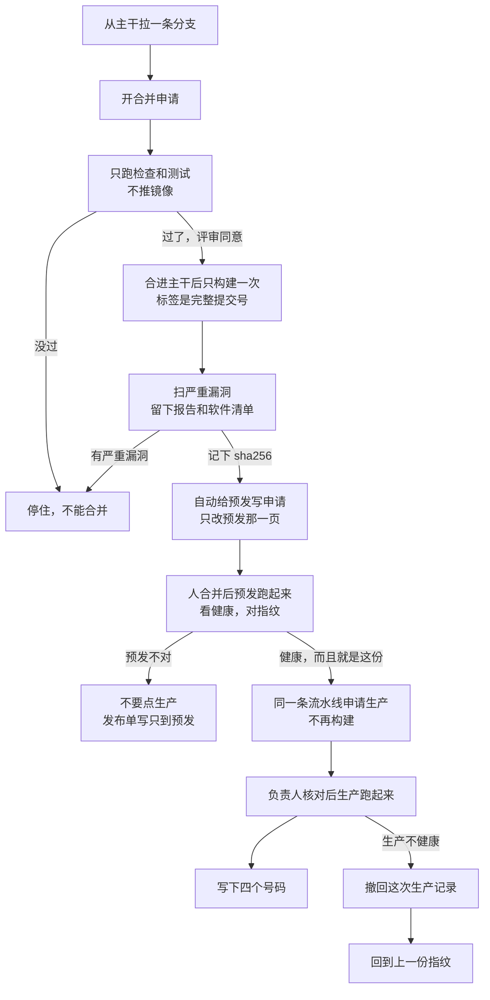

# 可落地的 CI/CD 发布流程

> 文档状态：可执行流程，按本文示例可以直接落地一条「构建一次、两级晋级、Git 回滚」的发布链路。
>
> 核对日期：2026-10-27
>
> 本文单独成篇。不安装 GitLab、Harbor、Argo CD 或 Kubernetes，也不替代生产治理清单。组件没就绪时，先做第 2 章的检查，检查不过就先把组件装好，再回到本文。

## 1. 文档概述

### 1.1 解决什么问题

把一次代码变更发布到 Kubernetes，并且事后能回答四个问题：哪个源码提交、哪条流水线、哪个镜像摘要、哪次 GitOps 合并把它送进了生产。

本文落地的流程是：

```text
功能分支开合并申请，先测试，不推镜像
  → 测试和评审都过了，才合并进 main
  → main 上再测一次，只构建一次，扫描严重漏洞，记下 sha256
  → 自动给预发开 GitOps 申请，人合并后 Argo CD 同步并做健康检查
  → 预发的指纹和健康都对，才在同一条流水线申请生产
  → 负责人核对「还是这一份」后合并，生产不再重新构建
  → 发布单留下四个号码。要撤回就 revert 那次生产记录
```

CI 只做测试、构建、扫描和提交 Git 变更。Argo CD 是唯一把声明同步进集群的组件。生产环境不向 CI 发放 kubeconfig。

### 1.2 适合哪些读者

负责把一条业务服务送进 Kubernetes 的开发负责人和平台工程师。默认读者已经用过 GitLab Merge Request、镜像仓库和 `kubectl get`。

### 1.3 读完能做什么

- 按第 4 章在三天内接通 staging 和 prod。
- 按第 5 章把示例文件放进两个仓库并跑通一次发布。
- 按第 6 章处理流水线是绿的、但集群没更新这类常见故障。
- 按第 4.11 章做一次可复现的回滚。

### 1.4 本文已经定下来的选择

下面这些选择是为了能先跑通。和现场不一致时，只改第 4.1 章的参数表，不要改阶段顺序。

| 选择 | 本文定法 | 原因 |
|---|---|---|
| 工具 | GitLab CI、Harbor、Argo CD、Kubernetes、Kustomize | 与现有运行环境一致 |
| 环境 | `staging`、`prod` 两个命名空间 | 少一个环境就少一套权限和同步策略 |
| 构建 | main 上构建一次，两个环境用同一个摘要 | 生产跑的就是预发验证过的那一层镜像 |
| 发布门禁 | GitOps 仓库的 Merge Request | 合并记录就是审批记录 |
| 集群入口 | 只有 Argo CD 持有部署权限 | CI 泄漏也不能直接改生产 |
| 回滚 | revert 发布那个 Git 提交 | 集群期望状态仍以 Git 为准 |

这些项不要在落地时自行改掉，除非参数表里明确写了替代方案：

- 飞书或钉钉审批。第一版用 GitLab Merge Request。审批系统是后续阶段。
- 按环境各构建一次镜像。生产必须复用 staging 的摘要。
- CI Job 里执行 `kubectl apply`。
- 使用 `latest` 或浮动分支名作为生产镜像标签。

标记 **【需要确认】** 的内容依赖现场版本和网络，文中给出了可执行的默认值，落地时改成现场值。

### 1.5 先用大白话看懂

可以把它想成寄一份包裹。

**合并申请**就是交作业。你在自己的分支上改完，把改动摊开给别人看。别人看过、测试过，才允许收进主干 `main`。GitHub 里的 Pull Request 是同一件事。

**保护分支**就是主干上的门禁。门禁打开之后，不能再直接 `git push` 到 `main`。想改主干，只能从合并申请里进去。代码仓库是这样，记录「生产该跑哪份镜像」的仓库也是这样。流水线可以递交申请，不能自己把门打开。

**镜像指纹**就是包裹上的封条。程序打成镜像之后，会算出一串 `sha256`。这串字钉死的是这一份内容。标签像外号，例如 `latest`，今天可以指这份，明天可以改指另一份。指纹不能改指向。预发试过的是哪份，生产就跑哪份。

谁干什么，看这张图。交互版在 [一次发布里，谁干什么](diagrams/cicd-architecture.html)。



一次发布要过四道门：测试、扫描、预发、负责人。交互版在 [从写代码到上线](diagrams/cicd-release-flow.html)。图比较高，打开后可以上下看；右上角可以切「代码进主干 / 只做一份镜像 / 放到生产」。



按这个顺序走一遍。每一步只做一件事。

1. **拉分支。** 从最新主干开一条自己的分支。主干有门禁，直接推会被拒绝。预期：分支上有你的提交，主干还是旧的。
2. **开合并申请。** 流水线只跑代码检查和测试。这个阶段没有镜像仓库密码。预期：测试是绿的；Harbor 里还没有这次的镜像。
3. **等人看过再合并。** 测试是红的就停。是绿的，评审看完差异再点合并。预期：主干多出这一次提交。
4. **只构建一次。** 主干上再测一遍，然后打镜像。标签用完整提交号，并算出 `sha256`。预期：Harbor 里有这个提交号，没有 `latest`。
5. **扫严重漏洞。** 有严重问题就停，这份镜像不能进预发。报告和软件清单留下来。预期：扫描通过后，才允许写预发申请。
6. **预发先跑这份。** 流水线自动开预发申请，里面只改预发那一页的指纹。人合并后，Argo CD 去同步。预期：状态是 Synced 和 Healthy，集群里的镜像等于这枚指纹，健康检查返回 200。
7. **预发不对就收住。** 不要点生产按钮。取消还停在按钮上的流水线，发布单写「只到预发」。预期：生产没变。取消流水线不会把已经上去的预发撤掉。
8. **申请生产。** 预发对了，在同一条流水线点生产。不会重新构建。预期：生产申请里的指纹，和预发正在跑的是同一串。
9. **负责人核对三件事再合并。** 指纹和构建产物一致；预发正在跑它；这次差异只改了生产那一页。预期：生产同步后同样健康，镜像指纹与预发相同。
10. **记下四个号码。** 源码提交、流水线链接、指纹、生产记录的提交。预期：以后要撤回，不用靠记忆。
11. **撤回走记录。** 优先再开一次申请，把那次生产变更撤回。生产已经不能等时，先关掉自动同步，退回上一份健康指纹，当天把记录补成同一份。预期：自动同步还开着时，只在界面点回滚，坏版本会马上被同步回来；所以要先关门，再退。

上面 11 步把一条发布走通。要把它当成生产系统，还得满足第 4.12 章：权限收死、镜像能验签、发布有窗口和第二个批准人、运行中挂了能发现、备份真的恢复过、回滚演练有记录。缺任何一条证据，就还只是预发链路。第 4.12 章通过之后的仓库隔离、准入验签、自动发布检查、偏离通知和凭据轮换，见 [CI/CD 生产加固设计](CI-CD生产加固设计.md)。

## 2. 前置条件

### 2.1 环境要求

本文默认一条业务服务、一个 Kubernetes 集群、两个命名空间。GitLab、Harbor、Runner、Argo CD 已经可用。多集群、多区域不在本文范围。

【需要确认】现场域名、项目路径、命名空间和版本。第 4.1 章的示例值不能直接当作生产地址。

### 2.2 软件及版本

落地前把实际版本记进参数表。下面是写本文时采用的能力基线，不是给现场指定的安装包。

| 软件 | 需要具备的能力 | 版本处理 |
|---|---|---|
| GitLab | Merge Request、Protected branch、CODEOWNERS、CI 变量、Project Access Token | 【需要确认】现网大版本 |
| GitLab Runner | Kubernetes executor，Job 能访问 GitLab 和 Harbor | 【需要确认】 |
| Harbor | Robot Account、标签不可变规则、漏洞扫描 | 【需要确认】 |
| Argo CD | `Application`、`AppProject`、自动同步 | 【需要确认】 |
| Kubernetes | 能从节点拉取 Harbor 镜像 | 【需要确认】1.27 及以上更稳妥 |
| Kustomize | `kustomize edit set image` | 流水线里固定安装 v5.4.3，【需要确认】Runner 是 amd64 还是 arm64 |

构建使用社区维护的 Kaniko（`ghcr.io/osscontainertools/kaniko`）。Google 的 Kaniko 仓库已经停止维护，GitLab 官方文档也不再给出 Kaniko 示例。生产 Job 必须把镜像改成现场验证过的摘要，不要长期使用浮动标签 `debug`。

### 2.3 开始前的检查

把示例主机名换成参数表里的值。每一条都要有成功输出，再进入第 4 章。

```bash
# GitLab 存活。期望 HTTP 200
curl -fsS -o /dev/null -w '%{http_code}\n' "https://gitlab.example.com/-/health"

# Harbor 存活。期望 HTTP 200
curl -fsS -o /dev/null -w '%{http_code}\n' "https://harbor.example.com/api/v2.0/health"

# 当前账号能看到目标集群
kubectl get ns

# Argo CD 的 Application CRD 已安装
kubectl get crd applications.argoproj.io
```

任意一条失败，就先恢复对应组件。不要带着失败检查往下配流水线。

### 2.4 必备知识

- 知道 Merge Request 和保护分支是什么：保护分支是「main 不能随便推送」的仓库规则。
- 知道镜像摘要（digest）是什么：镜像内容的 `sha256`，标签可以改指向，摘要不能。
- 知道 GitOps 是什么：集群里应该跑什么，写在 Git 里，由 Argo CD 去对齐。
- 会看 `kubectl get deploy,pod` 和 Argo CD 里的 `Synced` / `Healthy`。

## 3. 核心概念

### 3.1 两条仓库，两种权限

| 仓库 | 放什么 | 谁能合并到 main |
|---|---|---|
| `platform/demo-api` | 源码、Dockerfile、测试、`.gitlab-ci.yml` | 通过评审的开发者 |
| `platform/demo-api-gitops` | Kustomize 清单，按环境分目录 | staging 由维护者合并；`overlays/prod/` 还要代码所有者批准 |

源码仓库的 CI 机器人对 GitOps 仓库只有「推送功能分支 + 创建 Merge Request」的权限，没有合并 main 的权限。这样流水线不能自己把生产变更合进去。

### 3.2 一次发布里的四个标识

每次生产发布都要能同时拿出这四项：

| 标识 | 从哪来 | 用来做什么 |
|---|---|---|
| 源码 Commit SHA | GitLab 提交 | 回看代码 |
| Pipeline URL | GitLab 流水线 | 回看测试、扫描和谁点了生产按钮 |
| 镜像 Digest | Harbor，以及 `image-digest.txt` | 证明集群跑的是哪一层内容 |
| GitOps Commit SHA | GitOps 仓库的合并提交 | 回滚时 revert 这一次 |

少任何一项，这次发布都不算完成。

### 3.3 两个环境怎么走

```text
main 构建出 digest
        |
        +--自动--> staging 的 GitOps MR --人合并--> Argo CD 同步 staging
        |
        +--手工--> prod 的 GitOps MR --发布负责人合并--> Argo CD 同步 prod
```

staging 用来证明这个摘要能启动、健康检查能过、业务请求能通。prod 不再构建，只接收同一个摘要。

Argo CD 的同步策略：

| 环境 | 自动同步 | 自我修复 self-heal | 自动删除 prune |
|---|---|---|---|
| staging | 开 | 开 | 关 |
| prod | 开 | 开 | 关 |

门禁放在 Git 合并上，所以生产可以自动同步。自我修复的含义是：有人用 `kubectl edit` 改了集群，Argo CD 会改回 Git 里的内容。因此紧急回滚如果只在界面上点 Rollback，又没关自动同步，自我修复会把有问题的版本同步回来。第 4.11 章按这个约束写了顺序。

`prune` 关掉是为了避免第一版误删存储卷。以后要删除资源，单独开一次变更，不要顺手打开。

### 3.4 流水线阶段

源码仓库只有这条阶段顺序：

```text
verify → build → scan → promote
```

| 阶段 | Merge Request | main |
|---|---|---|
| verify | 跑 lint 和测试 | 再跑一次 |
| build | 不跑 | 构建并推送 `${COMMIT_SHA}`，写出摘要文件 |
| scan | 不跑 | 按摘要扫描，严重漏洞则失败 |
| promote | 不跑 | 自动给 staging 开 MR；`open-prod-mr` 要人手点 |

Merge Request 流水线不接触 Harbor 密码，也不接触 GitOps 令牌。这些变量设成 Protected，只对受保护分支可见。main 是受保护分支，功能分支不是。

## 4. 实现步骤

### 4.1 先填参数表

**做什么：** 把下面的表抄到变更单或仓库 README，换成现场值。后文命令都用这一列。

**为什么：** 域名和项目 ID 写错时，流水线会把镜像推到错误仓库，或把 Merge Request 开到错误项目。

**预期结果：** 表里没有 `example.com`，项目 ID 是数字。

| 参数 | 示例 | 现场值 |
|---|---|---|
| `GITLAB_HOST` | `gitlab.example.com` | 【需要确认】 |
| `GITLAB_API` | `https://gitlab.example.com/api/v4` | 【需要确认】 |
| `HARBOR_HOST` | `harbor.example.com` | 【需要确认】 |
| `HARBOR_PROJECT` | `apps` | 【需要确认】 |
| `IMAGE_REPO` | `harbor.example.com/apps/demo-api` | 【需要确认】 |
| 源码项目 | `platform/demo-api` | 【需要确认】 |
| GitOps 项目 | `platform/demo-api-gitops` | 【需要确认】 |
| `GITOPS_PROJECT_ID` | GitLab 项目页上的数字 ID | 【需要确认】 |
| staging 命名空间 | `demo-staging` | 【需要确认】 |
| prod 命名空间 | `demo-prod` | 【需要确认】 |
| Argo 项目名 | `apps` | 【需要确认】 |
| 发布组 | `platform/release-owners` | 【需要确认】 |
| Runner 架构 | `amd64` | 【需要确认】 |

下文为了能直接阅读，命令里仍写示例值。执行时以这张表为准。

### 4.2 准备 Harbor 项目和两个机器人账号

**做什么：**

1. 在 Harbor 建立项目 `apps`。
2. 建推送账号 `robot$apps+ci-push`：只有这个项目的推送和拉取，没有删除。
3. 建拉取账号 `robot$apps+cluster-pull`：只有拉取。
4. 给项目加标签不可变规则，匹配 `sha-*` 或 40 位十六进制标签。本文标签就是完整 Commit SHA，属于这一类。
5. 打开漏洞扫描。第一版流水线只因 `CRITICAL` 失败，`HIGH` 先记入报告。

**为什么：** CI 使用管理员账号时，一份泄漏的变量就能删仓库。推送和拉取分开后，集群里的拉取密文也不能拿来覆盖镜像。不可变标签保证同一个 SHA 不会被第二次推送悄悄换掉。

**预期结果：** 用推送账号能 `docker login`（或由第 5 章的 Kaniko Job 登录成功），用拉取账号不能删除镜像。Harbor 里还没有 `latest` 标签。

【需要确认】Harbor 扫描器是否已接好。没接好时，第 5 章的 Trivy Job 仍然可以在流水线里扫，不要为此停掉整个流程。

### 4.3 准备两个 GitLab 项目和机器人

**做什么：**

1. 创建 `platform/demo-api` 和 `platform/demo-api-gitops`。默认分支都是 `main`。
2. 两个仓库的 `main`：允许合并的人是 Maintainer，允许推送的人是 No one，并勾选「流水线必须成功」。
3. 在 GitOps 项目打开 Code owner approval。`CODEOWNERS` 见第 5.2 章，只保护 `overlays/prod/`。
4. 在 GitOps 项目创建 Project Access Token：
   - 角色：Developer
   - 范围：`api`、`write_repository`
   - 到期日写上，并在到期前轮换
   - 记下用户名（`GITOPS_USERNAME`）和令牌（`GITOPS_TOKEN`）
5. 在源码项目 → Settings → CI/CD → Variables，添加：

| 变量 | 属性 |
|---|---|
| `HARBOR_USER` | Masked。关闭 Expand variable reference |
| `HARBOR_PASSWORD` | Masked、Protected |
| `GITOPS_USERNAME` | Protected |
| `GITOPS_TOKEN` | Masked、Protected |

**为什么：** Developer 不能合并受保护的 `main`，所以机器人只能开 Merge Request。Harbor 机器人用户名里有 `$`，GitLab 默认会把 `$apps` 当成变量展开，登录名会被截断。关闭这个变量的展开后，`$` 会原样传给 Harbor。

**预期结果：** 用这个令牌可以推送 `promote/...` 分支，向 `main` 推送被拒绝。未受保护分支的流水线日志里看不到这四个变量。

【需要确认】当前 GitLab 版本里保护分支和 Code owner 的菜单位置。名称可能是 Settings → Repository → Protected branches。

### 4.4 放入源码、流水线和 GitOps 清单

**做什么：** 按第 5 章把文件放进两个仓库。源码仓库先合并 `.gitlab-ci.yml`、`ci/open-gitops-mr.sh`、`Dockerfile` 和应用代码。GitOps 仓库放入 `base/`、`overlays/staging/`、`overlays/prod/` 和校验流水线。

**为什么：** 晋级脚本只会改已有的 `kustomization.yaml`，不会凭空创建目录。文件不存在时，第一次发布一定会失败。

**预期结果：** 两个仓库的 `main` 上都有对应文件。此时还不要创建 Argo CD `Application`。占位摘要一旦被同步，Pod 会一直 `ImagePullBackOff`。

占位摘要是 64 个 `1`。它只用来让 Kustomize 文件合法。创建 `Application` 之前必须被真实摘要替换。

### 4.5 跑通第一次构建

**做什么：** 向源码 `main` 推一笔变更，或合并一个只改 README 的 Merge Request。看 `verify`、`build`、`scan`。`open-staging-mr` 先允许失败一次也行，但构建和扫描必须成功。

**为什么：** 先证明 Runner 能构建、能推 Harbor、能写出摘要，再让 GitOps 和 Argo CD 加入链路。问题会少一半。

**预期结果：**

- Harbor 里有标签等于完整 Commit SHA 的镜像。
- Job 产物 `image-digest.txt` 的内容匹配 `sha256:` 加 64 位小写十六进制。
- 没有名为 `latest` 的标签。
- `scan` Job 保存了 `trivy.txt` 和 `sbom.cdx.json`。

构建 Job 不需要特权模式，也不要挂载宿主机的 `docker.sock`。Kaniko 镜像本身以 root 运行。【需要确认】集群策略是否允许这个构建 Pod 以 root 运行。不允许的话，换已经在用的 rootless BuildKit，仍保持「构建一次、产出摘要文件」这个接口，后面的晋级脚本不用改。

【需要确认】Runner 能否访问 `github.com` 以下载 Kustomize。不能访问时，把对应架构的 `kustomize` 二进制放到源码仓库 `ci/kustomize`，脚本改为使用仓库里的文件。

### 4.6 合并第一条 staging 变更，再创建 Argo CD 应用

**做什么：**

1. 打开 `open-staging-mr` 创建的 Merge Request，确认描述里的摘要与 `image-digest.txt` 一致，然后合并。
2. 在集群创建拉取密文。密码用 Harbor 的拉取机器人，不要用推送机器人。

```bash
kubectl create namespace demo-staging
kubectl create namespace demo-prod

kubectl -n demo-staging create secret docker-registry harbor-pull \
  --docker-server=harbor.example.com \
  --docker-username='robot$apps+cluster-pull' \
  --docker-password='<拉取机器人密码>'

kubectl -n demo-prod create secret docker-registry harbor-pull \
  --docker-server=harbor.example.com \
  --docker-username='robot$apps+cluster-pull' \
  --docker-password='<拉取机器人密码>'
```

3. 确认 staging 清单已经不是占位摘要：

```bash
grep digest overlays/staging/kustomization.yaml
```

4. 应用第 5.2 章的 `AppProject` 和两个 `Application`。先只看 staging。

**为什么：** 拉取密文如果跟命名空间一起只存在于某次手工操作里，重建命名空间后 Pod 会再次拉不动镜像。本文把这件事写成明确步骤。密文不要提交进 Git。后续如果要放进 GitOps，用 Sealed Secrets、External Secrets 或 Vault，【需要确认】现场用哪一种。

**预期结果：**

```bash
kubectl -n argocd get application demo-api-staging \
  -o jsonpath='{.status.sync.status}{" "}{.status.health.status}{"\n"}'
```

输出：

```text
Synced Healthy
```

再核对集群里的镜像就是这次摘要：

```bash
kubectl -n demo-staging get deploy demo-api \
  -o jsonpath='{.spec.template.spec.containers[0].image}{"\n"}'
```

输出应类似：

```text
harbor.example.com/apps/demo-api@sha256:真实摘要
```

然后转发端口并访问健康检查：

```bash
kubectl -n demo-staging port-forward svc/demo-api 8080:80
curl -fsS http://127.0.0.1:8080/healthz
```

期望 HTTP 200，响应正文是 `staging`。这次发布的身份以镜像摘要为准，不靠响应正文里的字符串。

生产 `Application` 可以先创建。在生产清单还是占位摘要时，不要点同步。

### 4.7 日常发布：从分支到 staging

以后每一次正常发布都按这个顺序，不再改仓库结构。

**步骤 1：开功能分支，提 Merge Request**

做什么：从最新 `main` 拉分支，改代码，开 Merge Request。

为什么：Merge Request 流水线只跑测试，失败就不能合并。main 上不会出现没测过的提交。

预期结果：`verify` 是绿色。评审者看过差异后合并。

**步骤 2：main 流水线构建并扫描**

做什么：合并后等待 `build` 和 `scan`。

为什么：只有这条流水线产生的摘要可以进入环境。本地 `docker push` 不算发布。

预期结果：Harbor 出现新的 SHA 标签，`scan` 没有因为 `CRITICAL` 失败。

**步骤 3：合并 staging 的 GitOps Merge Request**

做什么：打开流水线给出的链接，看提交说明里的 `source`、`pipeline`、`digest`，合并。

为什么：这一下合并就是「允许预发运行这个摘要」。

预期结果：Argo CD 中 `demo-api-staging` 变为 `Synced Healthy`，Deployment 镜像与 Merge Request 里的摘要一致，`/healthz` 返回 200。

同一环境的晋级 Job 使用了 `resource_group`。上一次 staging 晋级还没结束时，下一次会排队，避免两笔提交交错改同一个文件。

如果上一条 staging Merge Request 还没合并，又来了一条新的：关掉旧的，只合并最新那条。旧分支基于更老的 `main`，后合并可能把摘要退回去。

**步骤 4：记一笔 staging 记录**

至少记下源码 SHA、Pipeline URL、摘要、staging 的 GitOps 合并 SHA、验证人、时间。第 4.10 章有模板。

### 4.8 日常发布：进入生产

**做什么：**

1. staging 验证通过后，在同一条源码流水线上点击 `open-prod-mr`。不要新打一个标签再构建一次。
2. 打开生产 GitOps Merge Request，核对三件事：
   - 摘要与这条流水线的 `image-digest.txt` 相同；
   - staging Deployment 当前镜像就是这个摘要；
   - 变更只改 `overlays/prod/kustomization.yaml` 的摘要。
3. `platform/release-owners` 里的人批准并合并。合并的人不应该是这批源码的唯一作者。只有一个人的小组做不到职责分离时，在发布单上写明原因，【需要确认】组织是否允许。
4. 等 `demo-api-prod` 变成 `Synced Healthy`。生产镜像摘要必须与 staging 相同；`/healthz` 返回 200，正文是 `prod`。

**为什么：** 生产按钮是手工的，流水线在按钮被点击前保持 `blocked`，避免「测试过了就等于上了生产」。真正放行的动作仍然是受保护分支上的合并，按钮本身只是把 Merge Request 开出来。

**预期结果：** 生产 Pod 的镜像摘要等于已经在 staging 验证过的摘要。发布单四项标识齐全。

这次不到生产：不要点击 `open-prod-mr`。流水线会停在 `blocked`。确认 staging 已经合格后，Cancel 这条流水线，并在发布单写「仅发布 staging」。Cancel 不会把已经同步的 staging 撤掉。

### 4.9 第一次落地的三天安排

| 天 | 完成标准 |
|---|---|
| 第 1 天 | 参数表填完；Harbor 两个机器人可用；两个仓库的 `main` 受保护；CI 变量已设好 |
| 第 2 天 | main 流水线推出第一个真实摘要；staging Merge Request 已合并；`demo-api-staging` 为 `Synced Healthy` |
| 第 3 天 | 生产 Merge Request 由第二个人合并；生产健康检查通过；按第 4.11 章完成一次回滚演练并再次发布回来 |

三天都做完，说明预发和生产的链路走得通。要承载真实用户，还要按第 4.12.7 章把七行证据补齐。只看到流水线变绿不算。

### 4.10 发布单

每次点击过 `open-prod-mr` 的发布，留一份记录。放在工单系统或 GitOps Merge Request 描述里都可以。

```text
服务: demo-api
环境: prod
源码 SHA:
源码 Pipeline URL:
镜像仓库: harbor.example.com/apps/demo-api
镜像 Digest:
staging GitOps SHA:
prod GitOps SHA:
staging 验证人 / 时间:
生产合并人 / 时间:
批准人是否为源码作者: 否
发布窗口:
扫描结论:
签名校验:
观察链接和 15 分钟结论:
健康检查:
回滚点（上一份 prod GitOps SHA）:
例外说明:
```

### 4.11 回滚

回滚是一次新的 Git 变更，不是在服务器上改镜像标签。

**正常回滚（优先这条）：**

做什么：

```bash
git clone "https://gitlab.example.com/platform/demo-api-gitops.git"
cd demo-api-gitops
git log --oneline -5 -- overlays/prod/kustomization.yaml
git checkout -b rollback/prod/<上一份好的短SHA>
git revert <把生产改坏的那次合并提交>
git push -u origin HEAD
```

然后按生产规则开 Merge Request、批准、合并。等 Argo CD 再次 `Synced Healthy`。

为什么：revert 之后 Git 里的摘要回到上一份已验证的内容，自动同步会把集群带回去。发布历史里看得到谁撤的。

预期结果：生产 Deployment 镜像变回发布单里的「回滚点」摘要，`/healthz` 返回 200。再补一份回滚发布单。

**紧急回滚（生产已经不可用，来不及等评审）：**

必须先停自动同步。自我修复开着时，只在界面点 Rollback，Argo CD 会马上把有问题的 Git 版本同步回来。

1. 在 Argo CD 打开 `demo-api-prod`，关掉 Auto-Sync。
2. 在 History 里选择发布单记录的上一个健康修订，执行 Rollback。
3. 确认 `Healthy`，以及镜像摘要是旧的那一份。
4. 立刻按上面的正常回滚补 Git revert 并合并。
5. 合并完成、集群与 Git 一致后，再打开 Auto-Sync，保持 self-heal 开、prune 关。

预期结果：故障期间集群停在旧摘要上；当天 Git 也回到同一摘要。不允许界面是旧版本、Git 仍是坏版本过夜。

没有 Argo CD 命令行时，用界面完成第 1、2、5 步。有命令行时对应关系是：

```bash
argocd app set demo-api-prod --sync-policy none
argocd app history demo-api-prod
argocd app rollback demo-api-prod <HISTORY_ID>
argocd app set demo-api-prod --sync-policy automated --self-heal --auto-prune=false
```

`<HISTORY_ID>` 从 `argocd app history` 的输出里抄，不要手填一个记得的数字。

数据库结构变更不在这条回滚里。镜像回到旧版本，不会把已经执行的表结构变更退回去。【需要确认】服务是否带迁移。有迁移时，迁移单独发布，并事先写清对应的回退脚本。

### 4.12 生产级标准

第 4.9 章的三天只证明链路能走通。生产级是指：同一次发布可以重复做、能被拦住、能核对、能撤回，而且事后拿得出证据。下表任何一行没有证据，就不要让真实用户流量进这个服务。

| 门禁 | 生产上必须成立的事 | 要留下的证据 |
|---|---|---|
| 权限 | 开发者不能直接推主干，也不能改生产集群；CI 没有 kubeconfig | 保护分支设置、一次被拒绝的推送、`kubectl auth can-i` 输出 |
| 供应链 | 只构建一次；严重漏洞、密钥泄漏、验签失败都会停 | 扫描报告、软件清单、签名校验输出 |
| 发布 | 预发和生产是同一枚指纹；生产由第二个人在窗口内合并 | 生产 Merge Request、发布单 |
| 运行 | 有资源限制、健康检查、滚动发布和中断预算 | `kubectl get deploy,pdb` |
| 观测 | 发布后 15 分钟内有人看错误和重启 | 仪表盘或日志链接写进发布单 |
| 密钥 | 密码不进 Git；机器人账号没有删除权限 | 变量设置截图或清单，仓库扫描结果 |
| 备份 | GitLab 备份能恢复出仓库；Harbor 的这份镜像还在 | 一次恢复记录 |
| 演练 | 做过一次真回滚，并且又发布回来 | 第 5.3 章第 7、8 步的记录 |

#### 4.12.1 把权限收死

**做什么：**

1. 两个仓库的 `main` 都不允许直接推送，合并前流水线必须成功。GitOps 仓库的 `overlays/prod/` 由 `platform/release-owners` 批准。打开「作者不能批准自己的合并申请」。CI 用的项目令牌保持 Developer，不能合并 `main`。
2. 生产相关 Job 使用受保护的 Runner 标签。构建 Pod 不要特权模式，不要挂载宿主机 `docker.sock`。
3. 用开发者自己的账号执行：

```bash
kubectl auth can-i update deployments -n demo-prod
kubectl auth can-i delete secrets -n demo-prod
```

**为什么：** 生产事故里，很多是同一个人既能改代码、又能改集群，出了问题没有第二个人看过。CI 一旦拿着集群管理员凭证，流水线变量泄漏就等于生产被改掉。

**预期结果：** 两条 `can-i` 都是 `no`。向 `main` 直接推送被拒绝。生产合并申请在作者本人那里点不了批准。

【需要确认】现场是否已经把开发者和平台工程师分成两个 Kubernetes 身份。如果所有人都用同一份管理员 kubeconfig，这一条不算通过。

#### 4.12.2 供应链要能验

**做什么：**

1. 合并申请阶段增加密钥扫描，扫到密钥就失败。不要把私有密钥、Harbor 密码、kubeconfig 提交进仓库。
2. `scan-image` 维持严重漏洞失败即停。高危漏洞给一个有截止日期的豁免清单，到期仍未处理就同样失败。豁免写在仓库里，写明漏洞编号、原因和日期。
3. 扫描通过后、写预发申请之前，给这枚指纹签名。`open-staging-mr` 和 `open-prod-mr` 都要依赖签名成功。生产合并前再验一次：

```bash
cosign verify --key cosign.pub \
  "harbor.example.com/apps/demo-api@sha256:真实指纹"
```

4. Dockerfile 的基础镜像改成现场镜像仓库里的指纹，不要长期使用浮动标签。

**为什么：** 标签可以被后一次推送改掉，未签名的镜像也可以被换成同名的另一份。签名把「这次构建的产物」和「集群里跑的那一份」钉在一起。密钥扫描挡住的是把密码写进 Git 这种一次就泄漏的错误。

**预期结果：** 故意放一个测试用密钥进分支时，合并申请失败。删掉之后才能合并。`cosign verify` 对这次指纹成功，对一个没签名的旧标签失败。软件清单作为流水线产物至少保留 90 天。

签名私钥放在受保护的 CI 变量里，不要写进仓库。公钥 `cosign.pub` 可以放进 GitOps 仓库，给批准人核对。Runner 如果出不了公网，就不要用依赖公网证书的 keyless 签名。【需要确认】签名私钥由谁生成、放在哪、多久轮换。工具版本也要钉死，不要用浮动标签。

密钥扫描可以加在 `verify` 阶段：

```yaml
secret-scan:
  stage: verify
  image:
    name: ghcr.io/gitleaks/gitleaks:v8.21.2
    entrypoint: [""]
  script:
    - gitleaks detect --source . --redact --verbose
  rules:
    - if: '$CI_PIPELINE_SOURCE == "merge_request_event"'
    - if: '$CI_COMMIT_BRANCH == $CI_DEFAULT_BRANCH'
```

【需要确认】`v8.21.2` 换成当时验证过的版本。扫描输出要打码，避免日志里再印出一次密钥。

#### 4.12.3 发布门

生产合并除了第 4.8 章的三件事，再加四条：

1. 批准人不是这批源码的作者。只有一个人的小组做不到时，不能把该服务标成生产级，发布单写明缺口。
2. 在约定的发布窗口内合并。【需要确认】窗口，例如工作日 10:00 到 18:00。窗口外要有发布负责人的书面例外，写进发布单。
3. 这次指纹已经在预发健康跑过，发布单里有验证人和时间。没有预发记录的指纹不能进生产。
4. 数据库结构变更单独走一次发布，并事先写好退回脚本。不要把「换镜像」和「改表结构」绑成同一步还指望镜像回滚把表也退回去。

同一服务的生产晋级保持 `resource_group`，避免两次发布叠在一起。

#### 4.12.4 运行时撑得住一次发布

第 5.2 章的 Deployment 要带滚动策略：最多多起一个新 Pod，旧 Pod 在新 Pod 就绪前不退出，并给一个明确的超时。副本数至少 2 时，加一个中断预算，避免节点维护时把两个副本同时赶下去。

```yaml
spec:
  replicas: 2
  progressDeadlineSeconds: 180
  minReadySeconds: 10
  strategy:
    type: RollingUpdate
    rollingUpdate:
      maxUnavailable: 0
      maxSurge: 1
```

```yaml
apiVersion: policy/v1
kind: PodDisruptionBudget
metadata:
  name: demo-api
spec:
  minAvailable: 1
  selector:
    matchLabels:
      app: demo-api
```

**预期结果：**

```bash
kubectl -n demo-prod get deploy demo-api \
  -o jsonpath='{.spec.strategy.rollingUpdate.maxUnavailable}{"\n"}'
kubectl -n demo-prod get pdb demo-api
```

第一条输出 `0`。第二条能看到 `demo-api`。健康检查、资源请求和限制、非 root、只读根文件系统保持第 5.2 章的写法。

#### 4.12.5 发布之后能看见

**做什么：** 生产合并后的 15 分钟，发布负责人看着这三件事：就绪副本数没有掉下去、Pod 没有反复重启、业务错误没有比发布前明显变多。把仪表盘或一条日志查询链接写进发布单。

**为什么：** `Synced Healthy` 只说明 Kubernetes 认为进程起来了。用户请求失败、错误率升高，往往要到日志和指标里才看得到。

**预期结果：** 发布单上有观察链接、观察人和结论。结论是「维持」或「已撤回」。没有结论的发布不算完成。

【需要确认】现场仪表盘的地址。没有现成仪表盘时，至少留下这段时间的 `kubectl get pods` 和一次真实业务请求的结果，并写明缺口。

#### 4.12.6 备份和恢复

生产级不是「有备份任务」，而是有人在隔离环境里恢复过。上线前留下两份记录：

1. 从 GitLab 备份恢复出 `demo-api` 和 `demo-api-gitops` 的 `main`，提交号和现网一致。
2. 用 Harbor 的拉取账号还能拉到发布单上的那枚指纹。拉不到，就说明镜像仓库的备份或保留策略不够。

【需要确认】现网用的备份工具和保留天数。GitOps 仓库在 GitLab 里，所以它跟着 GitLab 备份走。Argo CD 的应用定义以 Git 为准，不要只备份界面里的手工修改。

#### 4.12.7 上线判定

对照下面的清单。每一行都要有证据才能把服务交给真实用户。

| 编号 | 通过标准 |
|---|---|
| 1 | 第 5.3 章 8 步都做过，包括一次真回滚再发布回来 |
| 2 | 开发者账号对生产命名空间的写操作是 `no` |
| 3 | 密钥扫描、严重漏洞扫描、签名校验都会让流水线失败 |
| 4 | 生产目录有第二个批准人，并且作者不能自批 |
| 5 | 发布单有四个号码、预发验证人、观察链接和回滚点 |
| 6 | Deployment 滚动策略和 PodDisruptionBudget 已生效 |
| 7 | GitLab 恢复和 Harbor 拉镜像各有一次成功记录 |

第 4.9 章做完，只算预发链路可用。这 7 行都有证据，才算这个服务的发布系统达到生产级。

## 5. 完整示例

示例服务名是 `demo-api`。它只提供一个返回版本号的 HTTP 服务，用来把发布链路走通。业务仓库替换应用代码时，保留健康检查、CI 阶段和 GitOps 目录结构。

### 5.1 源码仓库

`app.py`：

```python
#!/usr/bin/env python3
"""最小 HTTP 服务：/healthz 返回当前环境名，用来确认进程已经接流量。"""

import os
from http.server import BaseHTTPRequestHandler, ThreadingHTTPServer


def health_body() -> bytes:
    version = os.environ.get("APP_VERSION", "dev")
    return (version + "\n").encode()


class Handler(BaseHTTPRequestHandler):
    def do_GET(self) -> None:
        if self.path in ("/", "/healthz"):
            body = health_body()
            self.send_response(200)
            self.send_header("Content-Type", "text/plain; charset=utf-8")
            self.send_header("Content-Length", str(len(body)))
            self.end_headers()
            self.wfile.write(body)
            return
        self.send_response(404)
        self.end_headers()

    def log_message(self, fmt: str, *args: object) -> None:
        # 避免健康检查刷满容器日志
        if args and str(args[0]).startswith("GET /healthz"):
            return
        super().log_message(fmt, *args)


if __name__ == "__main__":
    port = int(os.environ.get("PORT", "8080"))
    ThreadingHTTPServer(("0.0.0.0", port), Handler).serve_forever()
```

`test_app.py`：

```python
import app


def test_health_body_uses_version(monkeypatch) -> None:
    monkeypatch.setenv("APP_VERSION", "abc123")
    assert app.health_body() == b"abc123\n"
```

`Dockerfile`：

```dockerfile
# 【需要确认】落地后把基础镜像改成现场镜像仓库里的摘要，避免每次构建都漂到新的 slim
FROM python:3.12-slim

WORKDIR /app
COPY app.py .

RUN useradd --uid 65532 --create-home --shell /usr/sbin/nologin appuser
USER 65532

EXPOSE 8080
CMD ["python", "app.py"]
```

`.dockerignore`：

```text
.git
.gitlab-ci.yml
ci
__pycache__
tests
README.md
```

`ci/install-kustomize.sh`：

```bash
#!/usr/bin/env bash
# 安装固定版本的 Kustomize。重复执行不会重复下载。
set -euo pipefail

VERSION="${KUSTOMIZE_VERSION:-v5.4.3}"
ARCH="${KUSTOMIZE_ARCH:-amd64}"
TARGET="${KUSTOMIZE_BIN:-/usr/local/bin/kustomize}"

if [ -x "${TARGET}" ] && "${TARGET}" version | grep -q "${VERSION}"; then
  exit 0
fi

TMP="$(mktemp)"
URL="https://github.com/kubernetes-sigs/kustomize/releases/download/kustomize%2F${VERSION}/kustomize_${VERSION}_linux_${ARCH}.tar.gz"
curl -fsSL "${URL}" -o "${TMP}"
tar -tzf "${TMP}" | grep -qx 'kustomize'
tar -xzf "${TMP}" -C "$(dirname "${TARGET}")" kustomize
chmod 755 "${TARGET}"
rm -f "${TMP}"
kustomize version
```

`ci/open-gitops-mr.sh`：

```bash
#!/usr/bin/env bash
# 用本次构建的镜像摘要，给 staging 或 prod 开一条 GitOps Merge Request。
# 依赖：image-digest.txt、GITOPS_USERNAME、GITOPS_TOKEN、GITLAB_HOST、
#       GITLAB_API、GITOPS_PROJECT、GITOPS_PROJECT_ID、IMAGE_REPO、CI_* 变量。
set -euo pipefail

ENV="${1:?用法: open-gitops-mr.sh staging|prod}"
case "${ENV}" in
  staging|prod) ;;
  *) echo "环境只能是 staging 或 prod"; exit 1 ;;
esac

: "${GITOPS_USERNAME:?缺少 GITOPS_USERNAME}"
: "${GITOPS_TOKEN:?缺少 GITOPS_TOKEN}"
: "${GITLAB_HOST:?缺少 GITLAB_HOST}"
: "${GITLAB_API:?缺少 GITLAB_API}"
: "${GITOPS_PROJECT:?缺少 GITOPS_PROJECT}"
: "${GITOPS_PROJECT_ID:?缺少 GITOPS_PROJECT_ID}"
: "${IMAGE_REPO:?缺少 IMAGE_REPO}"

DIGEST="$(tr -d '[:space:]' < "${CI_PROJECT_DIR}/image-digest.txt")"
printf '%s\n' "${DIGEST}" | grep -Eq '^sha256:[0-9a-f]{64}$'
PLACEHOLDER="sha256:1111111111111111111111111111111111111111111111111111111111111111"
if [ "${DIGEST}" = "${PLACEHOLDER}" ]; then
  echo "拒绝把占位摘要写进 GitOps"
  exit 1
fi

WORKDIR="$(mktemp -d)"
trap 'rm -rf "${WORKDIR}"' EXIT

# 令牌已在 GitLab 设为 Masked。不要打印远程地址，也不要 set -x。
git clone --depth 1 \
  "https://${GITOPS_USERNAME}:${GITOPS_TOKEN}@${GITLAB_HOST}/${GITOPS_PROJECT}.git" \
  "${WORKDIR}/gitops"
cd "${WORKDIR}/gitops"
git config user.email "demo-api-bot@localhost"
git config user.name "demo-api-bot"

BRANCH="promote/${ENV}/${CI_COMMIT_SHA}"
if git ls-remote --exit-code --heads origin "${BRANCH}" >/dev/null 2>&1; then
  echo "分支 ${BRANCH} 已存在，下面会复用已打开的 Merge Request"
else
  git checkout -b "${BRANCH}"
  (
    cd "overlays/${ENV}"
    kustomize edit set image "${IMAGE_REPO}=${IMAGE_REPO}@${DIGEST}"
  )
  ACTUAL="$(kustomize build "overlays/${ENV}" | awk '/image: /{print $2; exit}')"
  if [ "${ACTUAL}" != "${IMAGE_REPO}@${DIGEST}" ]; then
    echo "渲染结果与摘要不一致: ${ACTUAL}"
    exit 1
  fi
  if git diff --quiet -- "overlays/${ENV}/kustomization.yaml"; then
    echo "摘要没有变化，不创建 Merge Request"
    exit 0
  fi
  git add "overlays/${ENV}/kustomization.yaml"
  git commit -m "promote(${ENV}): ${CI_PROJECT_NAME} ${CI_COMMIT_SHORT_SHA}

source: ${CI_COMMIT_SHA}
pipeline: ${CI_PIPELINE_URL}
digest: ${DIGEST}"
  git push origin "${BRANCH}"
fi

BODY="$(cat <<EOF
源码: ${CI_COMMIT_SHA}
流水线: ${CI_PIPELINE_URL}
镜像: ${IMAGE_REPO}@${DIGEST}

合并前核对：
1. staging Deployment 的镜像摘要与上面一致（生产 MR 必查）。
2. 本次差异只改 overlays/${ENV}/kustomization.yaml。
EOF
)"

RESPONSE="$(mktemp)"
HTTP_CODE="$(
  curl --silent --show-error --output "${RESPONSE}" --write-out '%{http_code}' \
    --request POST \
    --header "PRIVATE-TOKEN: ${GITOPS_TOKEN}" \
    --data-urlencode "source_branch=${BRANCH}" \
    --data-urlencode "target_branch=main" \
    --data-urlencode "remove_source_branch=true" \
    --data-urlencode "title=promote ${ENV} ${CI_COMMIT_SHORT_SHA}" \
    --data-urlencode "description=${BODY}" \
    "${GITLAB_API}/projects/${GITOPS_PROJECT_ID}/merge_requests"
)"

if [ "${HTTP_CODE}" = "201" ]; then
  jq -r '.web_url' "${RESPONSE}"
  exit 0
fi

if [ "${HTTP_CODE}" = "409" ]; then
  jq -r '.[] | .web_url' <<EOF
$(curl --silent --show-error \
  --header "PRIVATE-TOKEN: ${GITOPS_TOKEN}" \
  --get \
  --data-urlencode "state=opened" \
  --data-urlencode "source_branch=${BRANCH}" \
  "${GITLAB_API}/projects/${GITOPS_PROJECT_ID}/merge_requests")
EOF
  exit 0
fi

echo "创建 Merge Request 失败，HTTP ${HTTP_CODE}"
cat "${RESPONSE}"
exit 1
```

`.gitlab-ci.yml`：

```yaml
stages:
  - verify
  - build
  - scan
  - promote

variables:
  # 【需要确认】全部换成参数表里的现场值
  HARBOR_HOST: "harbor.example.com"
  IMAGE_REPO: "harbor.example.com/apps/demo-api"
  GITLAB_HOST: "gitlab.example.com"
  GITLAB_API: "https://gitlab.example.com/api/v4"
  GITOPS_PROJECT: "platform/demo-api-gitops"
  GITOPS_PROJECT_ID: "123"
  KUSTOMIZE_VERSION: "v5.4.3"
  KUSTOMIZE_ARCH: "amd64"
  # 【需要确认】改成现场验证过的 Kaniko 摘要后，删掉这个浮动标签
  KANIKO_IMAGE: "ghcr.io/osscontainertools/kaniko:debug"

workflow:
  rules:
    - if: '$CI_PIPELINE_SOURCE == "merge_request_event"'
    - if: '$CI_COMMIT_BRANCH == $CI_DEFAULT_BRANCH'
    - when: never

verify:
  stage: verify
  image: python:3.12-slim
  script:
    - python -m pip install --disable-pip-version-check pytest
    - pytest -q test_app.py
  rules:
    - if: '$CI_PIPELINE_SOURCE == "merge_request_event"'
    - if: '$CI_COMMIT_BRANCH == $CI_DEFAULT_BRANCH'

build-image:
  stage: build
  image:
    name: "$KANIKO_IMAGE"
    entrypoint: [""]
  script:
    - mkdir -p /kaniko/.docker
    - |
      umask 077
      cat > /kaniko/.docker/config.json <<EOF
      {"auths":{"${HARBOR_HOST}":{"username":"${HARBOR_USER}","password":"${HARBOR_PASSWORD}"}}}
      EOF
    - |
      /kaniko/executor \
        --context="dir://${CI_PROJECT_DIR}" \
        --dockerfile="${CI_PROJECT_DIR}/Dockerfile" \
        --destination="${IMAGE_REPO}:${CI_COMMIT_SHA}" \
        --digest-file="${CI_PROJECT_DIR}/image-digest.txt" \
        --push-retry=3 \
        --snapshot-mode=redo
    - grep -Eq '^sha256:[0-9a-f]{64}$' image-digest.txt
    - echo "digest=$(cat image-digest.txt)"
  artifacts:
    paths:
      - image-digest.txt
    expire_in: 30 days
  rules:
    - if: '$CI_COMMIT_BRANCH == $CI_DEFAULT_BRANCH'

scan-image:
  stage: scan
  image:
    name: aquasec/trivy:0.57.1
    entrypoint: [""]
  needs:
    - job: build-image
      artifacts: true
  script:
    - export TRIVY_USERNAME="${HARBOR_USER}"
    - export TRIVY_PASSWORD="${HARBOR_PASSWORD}"
    - DIGEST="$(tr -d '[:space:]' < image-digest.txt)"
    - trivy image --severity CRITICAL --exit-code 1 --ignore-unfixed --no-progress "${IMAGE_REPO}@${DIGEST}" | tee trivy.txt
    - trivy image --severity HIGH,CRITICAL --exit-code 0 --format cyclonedx --output sbom.cdx.json "${IMAGE_REPO}@${DIGEST}"
  artifacts:
    when: always
    paths:
      - trivy.txt
      - sbom.cdx.json
    expire_in: 90 days
  rules:
    - if: '$CI_COMMIT_BRANCH == $CI_DEFAULT_BRANCH'

.open-mr:
  stage: promote
  image: alpine:3.20
  needs:
    - job: build-image
      artifacts: true
    - job: scan-image
  before_script:
    - apk add --no-cache bash git curl jq tar
    - bash ci/install-kustomize.sh
  rules:
    - if: '$CI_COMMIT_BRANCH == $CI_DEFAULT_BRANCH'

open-staging-mr:
  extends: .open-mr
  resource_group: demo-api-staging
  script:
    - bash ci/open-gitops-mr.sh staging

open-prod-mr:
  extends: .open-mr
  resource_group: demo-api-prod
  when: manual
  script:
    - bash ci/open-gitops-mr.sh prod
```

`HARBOR_HOST` 不是密钥，写在文件里即可。机器人密码只放在 CI 变量里。密码如果包含双引号或反斜杠，登录用的 JSON 会被截断，换一个不含这两类字符的机器人密码。

本地先确认测试能过：

```bash
python3 -m pip install pytest
pytest -q test_app.py
```

期望最后一行是 `1 passed`。

### 5.2 GitOps 仓库

`base/deployment.yaml`：

```yaml
apiVersion: apps/v1
kind: Deployment
metadata:
  name: demo-api
spec:
  replicas: 2
  progressDeadlineSeconds: 180
  minReadySeconds: 10
  strategy:
    type: RollingUpdate
    rollingUpdate:
      maxUnavailable: 0
      maxSurge: 1
  selector:
    matchLabels:
      app: demo-api
  template:
    metadata:
      labels:
        app: demo-api
    spec:
      imagePullSecrets:
        - name: harbor-pull
      containers:
        - name: demo-api
          image: harbor.example.com/apps/demo-api:bootstrap
          ports:
            - containerPort: 8080
          env:
            - name: APP_VERSION
              value: dev
            - name: PYTHONDONTWRITEBYTECODE
              value: "1"
          readinessProbe:
            httpGet:
              path: /healthz
              port: 8080
          livenessProbe:
            httpGet:
              path: /healthz
              port: 8080
          resources:
            requests:
              cpu: 50m
              memory: 64Mi
            limits:
              cpu: "500m"
              memory: 128Mi
          securityContext:
            runAsNonRoot: true
            runAsUser: 65532
            allowPrivilegeEscalation: false
            readOnlyRootFilesystem: true
```

`base/service.yaml`：

```yaml
apiVersion: v1
kind: Service
metadata:
  name: demo-api
spec:
  selector:
    app: demo-api
  ports:
    - name: http
      port: 80
      targetPort: 8080
```

`base/pdb.yaml`：

```yaml
apiVersion: policy/v1
kind: PodDisruptionBudget
metadata:
  name: demo-api
spec:
  minAvailable: 1
  selector:
    matchLabels:
      app: demo-api
```

副本数少于 2 时不要加这份预算，否则单副本会被预算卡住，无法正常驱逐。

`base/kustomization.yaml`：

```yaml
apiVersion: kustomize.config.k8s.io/v1beta1
kind: Kustomization
resources:
  - deployment.yaml
  - service.yaml
  - pdb.yaml
```

`overlays/staging/kustomization.yaml`：

```yaml
apiVersion: kustomize.config.k8s.io/v1beta1
kind: Kustomization
namespace: demo-staging
resources:
  - ../../base
images:
  - name: harbor.example.com/apps/demo-api
    newName: harbor.example.com/apps/demo-api
    digest: sha256:1111111111111111111111111111111111111111111111111111111111111111
patches:
  - target:
      kind: Deployment
      name: demo-api
    patch: |
      - op: replace
        path: /spec/template/spec/containers/0/env/0/value
        value: staging
```

`overlays/prod/kustomization.yaml` 与 staging 相同，仅两处不同：`namespace` 为 `demo-prod`，环境变量值为 `prod`。副本数可以保持 2。

`CODEOWNERS`：

```text
/overlays/prod/ @platform/release-owners
```

`.gitlab-ci.yml`：

```yaml
stages:
  - validate

validate:
  stage: validate
  image: alpine:3.20
  before_script:
    - apk add --no-cache bash curl tar
    - bash ci/install-kustomize.sh
  script:
    - bash ci/check-gitops.sh
  rules:
    - if: '$CI_PIPELINE_SOURCE == "merge_request_event"'
    - if: '$CI_COMMIT_BRANCH == $CI_DEFAULT_BRANCH'
```

GitOps 仓库也放一份相同的 `ci/install-kustomize.sh`。

`ci/check-gitops.sh`：

```bash
#!/usr/bin/env bash
set -euo pipefail

kustomize build overlays/staging >/dev/null
kustomize build overlays/prod >/dev/null

if grep -R -n --include='*.yaml' ':latest' overlays base; then
  echo "清单里出现了 latest"
  exit 1
fi

# 渲染结果里的镜像必须带摘要，不能只剩一个可变标签
for env in staging prod; do
  IMAGE="$(kustomize build "overlays/${env}" | awk '/image: /{print $2; exit}')"
  printf '%s\n' "${IMAGE}" | grep -Eq '@sha256:[0-9a-f]{64}$' \
    || { echo "${env} 镜像没有摘要: ${IMAGE}"; exit 1; }
done
```

第一次提交如果还是占位摘要，这个检查仍然可以通过。创建 Argo CD 应用之前，人工确认摘要已经换成构建产物。

`argocd/project.yaml`：

```yaml
apiVersion: argoproj.io/v1alpha1
kind: AppProject
metadata:
  name: apps
  namespace: argocd
spec:
  description: demo-api 的发布边界
  sourceRepos:
    - https://gitlab.example.com/platform/demo-api-gitops.git
  destinations:
    - namespace: demo-staging
      server: https://kubernetes.default.svc
    - namespace: demo-prod
      server: https://kubernetes.default.svc
  clusterResourceWhitelist: []
  namespaceResourceWhitelist:
    - group: "*"
      kind: "*"
```

【需要确认】Argo CD 如果管理的是另一个集群，把 `server` 换成那个集群在 Argo CD 里登记的 API 地址，不要写成 CI 变量让流水线随便填。

`argocd/staging.yaml`：

```yaml
apiVersion: argoproj.io/v1alpha1
kind: Application
metadata:
  name: demo-api-staging
  namespace: argocd
spec:
  project: apps
  source:
    repoURL: https://gitlab.example.com/platform/demo-api-gitops.git
    targetRevision: main
    path: overlays/staging
  destination:
    server: https://kubernetes.default.svc
    namespace: demo-staging
  syncPolicy:
    automated:
      prune: false
      selfHeal: true
    syncOptions:
      - CreateNamespace=false
```

`argocd/prod.yaml` 把名字、路径、命名空间换成 prod，同步策略同样是 `prune: false`、`selfHeal: true`。`CreateNamespace=false` 是故意的：命名空间和拉取密文由第 4.6 章先建好，避免 Argo CD 建出一个没有拉取密文的空命名空间。

这两个应用的清单放在 GitOps 仓库里留档。第一次用平台账号执行：

```bash
kubectl apply -f argocd/project.yaml
kubectl apply -f argocd/staging.yaml
kubectl apply -f argocd/prod.yaml
```

应用创建之后，继续由平台仓库或手工变更管理它们，不要改成让业务 CI 调用 Argo CD API。

### 5.3 端到端验收

按顺序做一遍，每步留下命令输出或页面链接。

| 顺序 | 动作 | 通过标准 |
|---|---|---|
| 1 | 提交一个会失败的测试 | Merge Request 不能合并 |
| 2 | 修好测试并合并到 main | `build` 与 `scan` 成功，Harbor 有 SHA 标签 |
| 3 | 合并 staging GitOps MR | `demo-api-staging` 为 `Synced Healthy` |
| 4 | `port-forward` 后访问 `/healthz` | HTTP 200 |
| 5 | 比对 Deployment 镜像和 `image-digest.txt` | 完全相同 |
| 6 | 点击 `open-prod-mr` 并让第二个人合并 | 生产镜像摘要与 staging 相同 |
| 7 | revert 生产 GitOps 提交 | 生产回到上一摘要，再次 `Healthy` |
| 8 | 把第 7 步再正向发布回来 | 发布单能填满四个标识 |

第 7 步必须真做。没演练过的回滚步骤不算已经落地。

## 6. 常见问题与排查

### 6.1 流水线是绿色的，staging 没有变化

现象：源码 Pipeline 成功，集群还是旧镜像。

可能原因：staging 的 GitOps Merge Request 还没合并；Argo CD 看的分支不是 `main`；自动同步没开。

解决方法：打开那条 Merge Request 的状态。合并后再看：

```bash
kubectl -n argocd get application demo-api-staging \
  -o jsonpath='{.status.sync.status}{" "}{.status.sync.revision}{"\n"}'
```

`revision` 应该变成刚才合并的 GitOps 提交。仍是 `OutOfSync` 时，在 Argo CD 里看 Diff，不要对集群执行 `kubectl apply`。

### 6.2 Pod 一直 ImagePullBackOff

现象：Argo CD 已是 `Synced`，Pod 拉镜像失败。

可能原因：节点访问不了 Harbor；命名空间里没有 `harbor-pull`；机器人没有拉取权限；摘要仍是 64 个 `1`；用户名里的 `$` 被截断。

解决方法：

```bash
kubectl -n demo-staging get secret harbor-pull
kubectl -n demo-staging describe pod -l app=demo-api
```

事件里如果是 `not found`，回 Harbor 核对这个摘要是否存在。如果是 `unauthorized`，重建拉取密文，用户名与 Harbor 页面上的 Robot 名称逐字相同。

### 6.3 Harbor 登录失败，密码明明是对的

现象：Kaniko 报 `401 Unauthorized`，本地用同一密码可以登录。

可能原因：`HARBOR_USER` 含 `$`，被 GitLab 展开后变成 `robot+ci-push` 这类残缺用户名。

解决方法：编辑该 CI 变量，关闭 Expand variable reference。重新跑 `build-image`。不要在日志里打印 `/kaniko/.docker/config.json`。

### 6.4 创建 GitOps Merge Request 返回 401 或 403

现象：镜像已经推上去，`open-staging-mr` 失败。

可能原因：令牌没有 `api` 范围；令牌过期；`GITOPS_PROJECT_ID` 不是数字 ID；令牌角色不够，推不了分支。

解决方法：在 GitLab 上查看令牌的过期时间和范围。用同一令牌请求项目：

```bash
curl --silent --show-error --header "PRIVATE-TOKEN: ${GITOPS_TOKEN}" \
  "${GITLAB_API}/projects/${GITOPS_PROJECT_ID}" | jq '.path_with_namespace'
```

期望输出 `platform/demo-api-gitops`。对不上就改 ID，不要改脚本去猜项目。

### 6.5 生产 Merge Request 无法合并

现象：按钮是灰的，提示需要 Code owner 或流水线。

可能原因：批准人不是 `CODEOWNERS` 里的成员；GitOps 校验流水线失败；分支保护要求流水线成功，但校验 Job 没跑。

解决方法：看 GitOps 流水线日志。`check-gitops.sh` 失败时，按它打印的镜像行修，不要为了合并关掉「流水线必须成功」。

### 6.6 扫描一直失败，业务代码没改

现象：`scan-image` 因基础镜像的 `CRITICAL` 失败。

可能原因：`python:3.12-slim` 出现了新的严重漏洞，或 Trivy 拉不到漏洞库。

解决方法：先区分两类日志。连不上漏洞库时，检查 Runner 到 Trivy 数据库地址的网络，【需要确认】是否要配置内部镜像。确认是基础镜像漏洞时，升到已修复的基础镜像再构建。不要给这个 Job 加 `allow_failure: true`，也不要在命令末尾加 `|| true`。

### 6.7 回滚以后又回到了坏版本

现象：界面 Rollback 成功，几分钟后旧的坏镜像又出现。

可能原因：Auto-Sync 和 self-heal 仍开着，Git 里还是坏摘要。

解决方法：按第 4.11 章先关自动同步，再回滚，然后 revert Git。用下面两条对照，两边摘要一致才算回滚完成。

```bash
kubectl -n demo-prod get deploy demo-api \
  -o jsonpath='{.spec.template.spec.containers[0].image}{"\n"}'
git show main:overlays/prod/kustomization.yaml
```

### 6.8 两次发布叠在一起，staging 摘要来回变

现象：两个 Merge Request 后合并的那个反而更旧。

可能原因：旧分支不是从最新 `main` 拉的，后合并覆盖了新摘要。

解决方法：关掉旧的 `promote/staging/...` Merge Request，只保留最新源码流水线开出的那条。`resource_group` 只保证 Job 排队，不会替你关闭过期 Merge Request。

## 7. 注意事项与最佳实践

- CI 变量里只放 Harbor 机器人口令和 GitOps 令牌。不放 kubeconfig，不放 Argo CD 管理员令牌。
- 生产目录的变更只有一条路：Merge Request。Argo CD 里点出来的参数，当天写回 Git，否则自我修复会把它盖掉，或者反过来把集群和 Git 分成两套事实。
- 第一版不要打开 `prune`。要删除 Deployment、Service 以外的资源时，单独评审。
- 镜像标签用完整 `CI_COMMIT_SHA`。摘要才是集群里引用的值。不要再推一个 `latest`。
- Kaniko、Trivy、Kustomize、Python 基础镜像都要改成现场验证过的版本或摘要。【需要确认】内网镜像仓库的同步方式。
- `open-prod-mr` 保持手工，并且不要设 `allow_failure: true`。设了之后，流水线会在没人决定是否上生产时显示成功。
- 发布单不是可选笔记。没有四个标识，后面的回滚只能靠记忆。
- 一个服务跑通第 5.3 章的 8 项之后，再复制给下一个服务。复制时改的是参数表、镜像名和命名空间，不是阶段顺序。
- 第 4.12 章是生产流量的门槛。签名、第二个批准人、备份恢复记录和回滚演练都在这道门槛里。门槛通过之后，按 [CI/CD 生产加固设计](CI-CD生产加固设计.md) 做仓库隔离、准入验签、自动发布检查、偏离通知和凭据轮换。飞书或钉钉审批不在该设计里。外部审批以后如果要加，未批准的指纹仍然不能进入 Argo CD 正在跟踪的生产分支。

角色可以按这个分工，人少时可以兼任，生产合并人和源码作者尽量不是同一人：

| 事项 | 开发 | 评审 | 发布负责人 | 平台 |
|---|---|---|---|---|
| 功能分支和测试 | 负责 | 批准合并 | 知道即可 | |
| Runner、Harbor、Argo CD 可用 | | | | 负责 |
| 合并 staging GitOps | 负责 | | 需要时看一眼 | |
| 合并 prod GitOps | 提供验证结果 | | 批准并合并 | 异常时协助 |
| 回滚 | 提供上一份健康摘要 | | 执行 revert | 紧急时协助关自动同步 |

## 8. 总结

这条流程的核心是：main 上构建一次，Harbor 留下不可变标签和摘要，staging 与 prod 通过 GitOps Merge Request 使用同一个摘要，Argo CD 负责同步，回滚时 revert 那次 Git 提交。

链路走通看第 5.3 章的 8 项。能不能承载生产流量，看第 4.12.7 章的 7 行是不是都有证据。只看到流水线变绿，两边都不算完成。

建议的下一步：

1. 填写第 4.1 章参数表，把所有 `example.com` 换成现场值。
2. 按第 4.9 章做完预发、生产和一次撤回。
3. 按第 4.12.7 章补齐权限、签名、备份恢复和观察记录。
4. 七行都有证据之后，按 [CI/CD 生产加固设计](CI-CD生产加固设计.md) 的顺序做仓库隔离和准入。不要在证据齐之前把准入改成强制拒绝。
