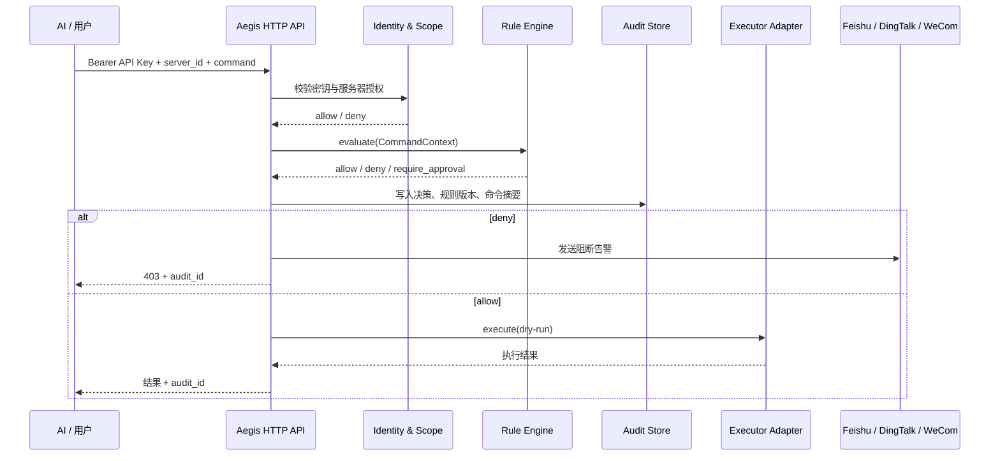

# Aegis MVP 架构与扩展边界

## 请求路径



## 数据边界

| 表 | 作用 | 关键约束 |
| --- | --- | --- |
| `principals` | 用户或 AI 身份 | 只存 API Key 的 scrypt 哈希 |
| `servers` | 受保护服务器资产 | 地址由管理员写入，不接受调用方任意 host |
| `access_grants` | 身份到资产的可见范围 | `(principal_id, server_id)` 联合主键 |
| `rules` | 可配置规则 | `id` 稳定，`pattern`、`reason`、`severity` 可审计 |
| `audit_events` | 每次决策和动作 | 保存 `decision`、`rule_id`、`audit_id`、时间 |

## 新规则怎么加

MVP 的规则引擎只依赖 `evaluate(command, context)` 的结果。新规则可以先通过管理接口写入数据库，不需要改请求路由。规则增加到需要上下文判断时，建议按下面的结构拆分：

```python
class Rule:
    id: str
    version: str

    def evaluate(self, context: CommandContext) -> RuleDecision:
        """返回 allow、deny 或 require_approval。"""
```

`CommandContext` 统一包含 `principal`、`server`、`action`、`command`、资产标签、来源 IP 和时间。规则按照 `priority` 从高到低计算，拒绝优先；审批型规则返回 `require_approval`，由后续审批服务继续同一个 `execution_id`。规则命中结果要保存规则 ID 和版本，避免规则更新后无法解释旧事件。

当前 MVP 的正则规则有 512 个字符的长度上限和 256 条启用规则上限，并拒绝反向引用、部分高级回溯构造及明显的嵌套/歧义重复结构。Python 标准库 `re` 没有匹配超时，因此这组限制只是常见 ReDoS 形状的防护；面对不完全可信的规则编写者，生产环境应切换到具备线性时间保证的正则引擎，或把匹配放到可强制超时的隔离进程。

推荐扩展顺序：

1. `RegexRule`：快速拦截明显危险命令。
2. `PathRule`：限制文件路径和敏感目录。
3. `RateLimitRule`：限制身份、资产和时间窗口内的次数。
4. `ApprovalRule`：高风险动作进入飞书/钉钉/企业微信审批。
5. OPA/Rego 适配器：规则规模变大后把策略文件独立版本化。

## 容器部署

本地 `docker-compose.yml` 默认使用 SQLite named volume。生产环境通过 `AEGIS_DATABASE_URL` 使用 PostgreSQL backend，并由版本化迁移工具管理 schema；当前代码的 PostgreSQL schema bootstrap 只用于首次启动验证。审计事件可以先追加到本地 hash-chain JSONL staging，但真正的不可变归档必须写入启用 Object Lock/WORM、保留策略和独立权限的对象存储。多副本模式需要共享 PostgreSQL 和可靠的归档投递/重试机制，不能直接把 SQLite volume 挂到多个副本。

配置 `AEGIS_AUDIT_ARCHIVE_S3_BUCKET` 时，服务使用 S3 兼容 Object Lock 适配器，以 `COMPLIANCE` 保留模式写入每个审计事件；bucket 的版本控制、Object Lock 和保留策略必须在服务外预先创建并由独立权限管理。归档投递失败是否阻断请求由 `AEGIS_AUDIT_ARCHIVE_REQUIRED` 决定；数据库写入与对象归档不是同一个事务，仍需补偿扫描和重试任务。

执行器通过 `app/executor.py` 的 `Executor` 接口隔离。当前 `DryRunExecutor` 只返回计划执行内容；真实 SSH、Kubernetes Exec 或云厂商 Session Manager 都应实现新的 adapter，并继续复用身份、范围、规则和审计路径。

## 指标

- `/healthz`：进程存活。
- `/readyz`：数据库可访问。
- `/metrics`：Prometheus 文本格式，包含请求、命令、阻断和告警投递计数。
- `/api/v1/dashboard`：前端用的资产、身份、规则、审计和阻断汇总。

默认 dry-run executor 不连接真实服务器，不能把 `accepted` 当成真实命令已执行；设置 `AEGIS_EXECUTOR_MODE=ssh` 后会使用 `SSHExecutor`，仍要求资产中登记用户、端口和 known_hosts。接入 Kubernetes Exec、云厂商 Session Manager 或交互式会话时必须新增独立 adapter，并在 adapter 层再次实施超时、命令 allowlist、凭据隔离和会话审计。

命令执行入口采用“结构化命令白名单 + 规则拒绝”的顺序：先把输入拆成命令名和参数，拒绝 Shell 元字符与不在白名单中的命令，再执行现有危险规则。SSH 适配器会再次分词并以参数数组调用客户端；这不是 Shell 沙箱，生产环境仍应使用最小权限账号、按环境收敛 `AEGIS_ALLOWED_COMMANDS`，并用目标主机防火墙或安全组阻断绕过 Aegis 的直连路径。
