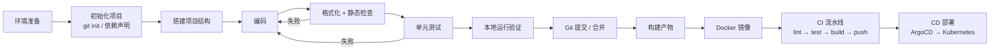

# Python 与 Go 标准开发流程详解

从零开始开发一个后端服务时的完整标准流程，覆盖：环境准备 → 项目初始化 → 依赖管理 → 编码 → 检查与测试 → 本地运行 → Git 提交 → 构建 → Docker 化 → CI/CD → 部署到 Kubernetes。

文中所有示例均来自本仓库真实工程：

- Python：[python/status-api](../python/status-api/)（标准库）、[python/fastapi-prometheus-status](../python/fastapi-prometheus-status/)（FastAPI）
- Go：[go/todo-api](todo-api/)、[go/status-api](status-api/)

---

## 1. 总体流程总览

无论哪种语言，工程化流程的主线是相同的，区别只在每个环节使用的工具：



| 环节 | Python | Go |
|------|--------|----|
| 环境隔离 | 每项目一个 venv 虚拟环境 | 无 venv，模块缓存全局共享 |
| 依赖声明 | `requirements.txt`（pip） | `go.mod` / `go.sum`（工具链内置） |
| 入口约定 | 包内 `__main__.py`，`python3 -m 包名` 启动 | `main.go` 的 `func main()`，`go run .` |
| 代码风格 | ruff / black（第三方） | `gofmt` 官方强制统一 |
| 静态检查 | mypy / ruff，`python3 -m compileall` | `go vet` 内置 |
| 测试 | unittest 内置 / pytest（主流） | `go test` 内置，测试与源码同包 |
| 交付物 | 解释器 + 源码 + 依赖 | 单个静态二进制，可交叉编译 |
| 容器镜像 | 基于 `python:3.12-slim`，百 MB 级 | 多阶段构建 → distroless/scratch，几 MB ~ 十几 MB |

---

## 2. Python 标准开发流程

### 2.1 环境准备（一次性）

```bash
# macOS（推荐 brew 或 pyenv 管理多版本）
brew install python@3.12

# 验证
python3 --version    # 期望 3.10+
```

多版本并存的项目建议用 `pyenv` 按项目固定版本；服务器上也可用 `uv` 等新型工具链，但入门阶段 brew / 官方安装包即可。

### 2.2 初始化项目

```bash
mkdir -p ~/projects/my-api && cd ~/projects/my-api
git init
```

创建 `.gitignore`，至少包含：

```gitignore
.venv/
__pycache__/
*.pyc
.env
```

> `.env` 永远不进 Git，只提交 `.env.example` 模板。

### 2.3 创建虚拟环境（每个项目必做）

```bash
python3 -m venv .venv
source .venv/bin/activate
python -m pip install --upgrade pip
```

激活后命令行提示符出现 `(.venv)` 前缀。**每个 Python 项目一个独立 venv**，不装到系统 Python 里，避免依赖互相污染。退出用 `deactivate`。

### 2.4 依赖管理

新建 `requirements.txt`，写明包名和版本范围（参考 [python/fastapi-prometheus-status/requirements.txt](../python/fastapi-prometheus-status/requirements.txt)）：

```text
fastapi>=0.115,<1
httpx>=0.27,<1
uvicorn[standard]>=0.30,<1
python-dotenv>=1.0,<2
```

安装：

```bash
pip install -r requirements.txt
```

约定：

- `>=x,<y` 限定大版本，避免升级引入破坏性变更；
- 纯标准库项目（如 [python/status-api](../python/status-api/)）可以不建 `requirements.txt`；
- 需要完全复现环境时，用 `pip freeze > requirements-lock.txt` 锁定精确版本。

### 2.5 标准项目结构

以 `python/status-api` 为模板的服务型项目结构：

```text
my-api/
├── .env.example          # 配置模板，入库
├── .gitignore
├── README.md
├── requirements.txt      # 依赖声明（标准库项目可省略）
├── my_api/               # 包目录，全部业务代码
│   ├── __init__.py
│   ├── __main__.py       # 入口：支持 python3 -m my_api
│   ├── config.py         # 配置读取（环境变量 / .env）
│   ├── http_api.py       # HTTP 接口层
│   └── collectors.py     # 业务逻辑
└── tests/
    └── test_my_api.py
```

要点：

- 可运行的包靠 `__main__.py`，启动方式统一为 `python3 -m my_api`；
- 代码放包目录里，而不是散落一堆顶层脚本；
- `tests/` 与包目录平级。

### 2.6 配置管理

- 本地开发：复制模板 `cp .env.example .env`，填写真实值，`chmod 600 .env`；
- 程序启动时读取 `.env`，**已经在 Shell 导出的同名环境变量优先于文件值**；
- 生产环境：配置来自 K8s 的 ConfigMap / Secret，不落文件。

参考 [python/status-api/README.md](../python/status-api/README.md) 第 3、6 节。

### 2.7 编码规范

- 遵循 PEP 8（4 空格缩进、snake_case 命名、每行 ≤ 88~120 字符）；
- 公共函数写类型标注（`def collect(port: int) -> dict:`），便于 mypy 检查；
- 模块级常量大写（`DEFAULT_PORT = 8080`）；
- 一个模块一个职责：配置、HTTP 层、采集逻辑分开（对照 `status_api/` 下的文件划分）。

### 2.8 格式化与静态检查

提交前至少跑一遍编译检查（标准库即可，无需安装）：

```bash
python3 -m compileall -q my_api
```

正式项目推荐组合（按需安装到 venv）：

```bash
pip install ruff mypy
ruff format .        # 格式化（替代 black）
ruff check .         #  lint（替代 flake8/isort）
mypy my_api          # 类型检查
```

### 2.9 测试

标准库内置 `unittest`（`python/status-api` 即用此方案）：

```bash
PYTHONPATH=. python3 -m unittest discover -s tests -v
```

第三方主流是 `pytest`（断言更简洁、插件丰富）：

```bash
pip install pytest pytest-cov
pytest -v --cov=my_api
```

约定：每个核心模块至少一个测试文件；**测试不通过不提交**。

### 2.10 本地运行与验证

```bash
# 标准库项目
python3 -m my_api

# FastAPI 项目（开发模式自动重载）
uvicorn app.main:app --reload --port 8080
```

另开终端验证接口：

```bash
curl -sS http://127.0.0.1:8080/healthz
```

### 2.11 Git 提交

- 分支开发：`git checkout -b feature/xxx`，完成后合并回主干；
- 提交信息写清「做什么 + 为什么」，如 `feat: 增加 /api/v1/host 接口`；
- 提交前确认 `.env`、`.venv`、`__pycache__` 未被 `git add`。

详见 [Git-命令详解.md](../CI-CD/Git-命令详解.md)。

### 2.12 Docker 化

参考 [python/sls/Gitlab/Dockerfile](../python/sls/Gitlab/Dockerfile) 的标准写法（slim 基础镜像 → 装依赖 → 拷代码 → 健康检查）：

```dockerfile
FROM python:3.12-slim-bookworm

WORKDIR /app
ENV PYTHONUNBUFFERED=1

COPY requirements.txt .
RUN pip install --no-cache-dir -r requirements.txt

COPY . .

EXPOSE 8080
HEALTHCHECK --interval=10s --timeout=3s --retries=3 \
    CMD python -c "import urllib.request; urllib.request.urlopen('http://127.0.0.1:8080/healthz')"

CMD ["python3", "-m", "my_api"]
```

同时配 `.dockerignore`（排除 `.venv`、`.git`、`__pycache__`、`.env`），本地验证：

```bash
docker build -t my-api:dev .
docker run --rm -p 8080:8080 --env-file .env my-api:dev
```

更多镜像构建细节见 [Docker镜像构建流程.md](../CI-CD/Docker镜像构建流程.md) 和 [Docker-Build从入门到高级.md](../容器编排/Docker-Build从入门到高级.md)。

### 2.13 CI 流水线

GitLab CI 典型四阶段（完整语法见 [GitLab-CI-配置语法.md](../CI-CD/GitLab-CI-配置语法.md)）：

```yaml
stages: [lint, test, build, deploy]

lint:
  stage: lint
  image: python:3.12-slim
  script: pip install ruff && ruff check .

test:
  stage: test
  image: python:3.12-slim
  script:
    - pip install -r requirements.txt
    - PYTHONPATH=. python3 -m unittest discover -s tests -v

build:
  stage: build
  script: docker build -t $REGISTRY/my-api:$CI_COMMIT_SHORT_SHA . && docker push $REGISTRY/my-api:$CI_COMMIT_SHORT_SHA

# deploy 阶段由 ArgoCD 监听 GitOps 仓库自动完成
```

### 2.14 部署到 Kubernetes

由 CD（ArgoCD）完成，应用侧需要保证：

- 提供 `/healthz` 供 liveness/readiness 探针使用；
- 配置全部走环境变量（ConfigMap/Secret 注入）；
- 需要访问 K8s API 时绑定**只读** ServiceAccount + RBAC（完整步骤见 [python/status-api/README.md](../python/status-api/README.md) 第 4 节：集群内用 ServiceAccount Token，集群外用独立只读 Token + CA 文件）。

---

## 3. Go 标准开发流程

### 3.1 环境准备（一次性）

```bash
# macOS
brew install go

# 验证（本仓库工程要求 1.24+）
go version
```

Go 不需要虚拟环境：第三方模块统一缓存在 `$GOPATH/pkg/mod`（默认 `~/go/pkg/mod`），按版本全局共享。

### 3.2 初始化项目

```bash
mkdir -p ~/projects/my-api && cd ~/projects/my-api
git init

# 初始化模块，模块名通常用域名形式（个人练习可用 example.com/ 前缀）
go mod init example.com/my-api
```

生成 `go.mod`（参考 [go/todo-api/go.mod](todo-api/go.mod)）：

```go
module example.com/my-api

go 1.24.5
```

`.gitignore` 至少包含：

```gitignore
.env
/my-api        # go build 产出的与目录同名的二进制
```

### 3.3 依赖管理

```bash
go get github.com/spf13/cobra@latest   # 添加依赖
go mod tidy                            # 增删引用后同步 go.mod / go.sum
```

约定：`go.mod` 和 `go.sum` 都必须提交；不需要手动编辑版本，`go mod tidy` 会按代码实际 import 自动整理。

### 3.4 标准项目结构

小型服务（如 `go/todo-api`）扁平即可，按职责拆文件：

```text
my-api/
├── .env.example
├── .gitignore
├── README.md
├── go.mod / go.sum
├── main.go        # 入口 func main()
├── server.go      # HTTP 服务装配
├── handler.go     # 请求处理
├── store.go       # 数据存储
└── server_test.go # 测试，与源码同包
```

中大型项目采用社区标准布局：`cmd/应用名/main.go`（入口）、`internal/`（私有代码）、`pkg/`（可公开库）、`api/`（OpenAPI/proto）。

### 3.5 配置管理

与 Python 完全相同的约定：

- 本地 `cp .env.example .env` → `chmod 600 .env`，Shell 已导出变量优先；
- `.env` 不进 Git；
- 实现方式参看 `go/status-api` 的 `env.go`（程序启动时自行解析 `.env`）。

### 3.6 编码规范

- `gofmt` 是唯一官方风格（Tab 缩进），保存即格式化，不参与讨论；
- 包名小写单词；导出标识符首字母大写；
- 错误处理显式化：`if err != nil { return err }`，不允许吞掉 err；
- 没有用过的 import 和变量直接编译报错，保持代码干净。

### 3.7 静态检查

```bash
gofmt -l .          # 列出不符合格式的文件（有输出 = 不合格）
go vet ./...        # 官方静态检查（本仓库 go/status-api 流水线即含此步）
```

### 3.8 测试

测试文件命名 `xxx_test.go`，与源码**同目录同包**（参考 `go/status-api/server_test.go`）：

```bash
go test ./...            # 跑全部测试
go test -race ./...      # 数据竞争检测（并发代码建议跑）
go test -cover ./...     # 覆盖率
```

主流写法是表驱动测试（构造 `[]struct{ name string; in ...; want ... }` 循环断言）。同样约定：**测试不通过不提交**。

### 3.9 本地运行与验证

```bash
go run .
# 本机默认缓存目录无写权限时
GOCACHE=/tmp/my-api-gocache go run .
```

另开终端：

```bash
curl -sS http://127.0.0.1:8080/healthz
```

### 3.10 构建产物

```bash
# 本机构建
go build -o bin/my-api .

# 发布用：去掉调试信息 + 注入版本号
go build -ldflags="-s -w -X main.version=$(git rev-parse --short HEAD)" -o bin/my-api .

# 交叉编译 Linux x86_64 纯静态二进制（容器部署最常用的形态）
CGO_ENABLED=0 GOOS=linux GOARCH=amd64 go build -o bin/my-api-linux .
```

`CGO_ENABLED=0` 产出无任何动态库依赖的静态二进制，可以直接放进 `scratch` 空镜像运行——这是 Go 交付流程和 Python 最大的区别：**目标机器不需要安装任何运行时**。

### 3.11 Git 提交

与 Python 一致（分支 + 规范提交信息），此外注意不要把 `go build` 产出的二进制提交进库。

### 3.12 Docker 化

Go 的镜像用**多阶段构建**：第一阶段编译，第二阶段只拷二进制，最终镜像可以小到几 MB：

```dockerfile
# ---- 构建阶段 ----
FROM golang:1.24-bookworm AS build
WORKDIR /src
COPY go.mod go.sum* ./
RUN go mod download
COPY . .
RUN CGO_ENABLED=0 GOOS=linux go build -ldflags="-s -w" -o /out/my-api .

# ---- 运行阶段 ----
FROM gcr.io/distroless/static-debian12
COPY --from=build /out/my-api /my-api
EXPOSE 8080
ENTRYPOINT ["/my-api"]
```

本地验证：

```bash
docker build -t my-api:dev .
docker run --rm -p 8080:8080 --env-file .env my-api:dev
```

> 如果程序需要读 `.env` 文件本身（而非环境变量注入），distroless 需额外拷贝文件；生产建议直接用 `--env-file` / K8s env 注入，镜像内不带配置。

### 3.13 CI 流水线

```yaml
stages: [lint, test, build, deploy]

lint:
  stage: lint
  image: golang:1.24
  script: test -z "$(gofmt -l .)" && go vet ./...

test:
  stage: test
  image: golang:1.24
  script: go test -race ./...

build:
  stage: build
  script: docker build -t $REGISTRY/my-api:$CI_COMMIT_SHORT_SHA . && docker push $REGISTRY/my-api:$CI_COMMIT_SHORT_SHA
```

Runner 资源紧张时的构建方案见 [海外弹性GitLab-Runner构建方案.md](../CI-CD/海外弹性GitLab-Runner构建方案.md)；无 Docker daemon 环境可用 [Kaniko-容器镜像构建工具.md](../CI-CD/Kaniko-容器镜像构建工具.md)。

### 3.14 部署到 Kubernetes

与 Python 相同的要点：`/healthz` 探针、环境变量配置、只读 RBAC（[go/status-api/README.md](status-api/README.md) 第 4、7 节有完整的 ServiceAccount + ClusterRole 操作步骤）。额外优势：单容器一个静态二进制，启动快、攻击面小、资源占用低。

---

## 4. 从零开始的检查清单

新项目按此顺序逐项打勾：

- [ ] 安装语言工具链（`python3 --version` / `go version` 符合要求）
- [ ] `mkdir` + `git init` + `.gitignore`（含 `.env`）
- [ ] 依赖声明就位（`requirements.txt` / `go mod init`）
- [ ] （仅 Python）创建并激活 venv
- [ ] 搭好目录结构与入口（`__main__.py` / `main.go`）
- [ ] `.env.example` 写清全部配置项，本地 `cp` 出 `.env` 并 `chmod 600`
- [ ] 编码 → 格式化 + 静态检查通过
- [ ] 测试通过（`unittest discover` / `go test ./...`）
- [ ] 本地跑起来，`curl` 验证接口
- [ ] 写 README：启动方式、环境变量表、测试命令
- [ ] 分支提交，合并回主干
- [ ] Dockerfile 本地 `docker build` + `docker run` 验证
- [ ] 接 CI：lint → test → build → push 四个阶段全绿
- [ ] CD：ArgoCD 发布，K8s 探针/Secret/RBAC 配置到位

## 5. 常见问题

| 现象 | 原因与处理 |
|------|-----------|
| `pip install` 装到了系统 Python | 忘记 `source .venv/bin/activate`；每开新终端都要重新激活 |
| 部署后依赖缺失 | 只用 `pip install xxx` 没写进 `requirements.txt` |
| 密钥泄露到 Git | `.env` 没加进 `.gitignore`；立即轮换密钥并清理历史 |
| `go run` 报缓存目录权限错误 | 用 `GOCACHE=/tmp/xxx go run .`（见 go/status-api README 第 3 节） |
| 容器里 `go build` 二进制无法启动 | 在 alpine/scratch 里跑了带 CGO 的二进制；构建时加 `CGO_ENABLED=0` |
| `go mod` 拉依赖慢 | 配置代理 `GOPROXY=https://goproxy.cn,direct` |
| 测试过了但线上挂 | 只有单元测试没有本地 `curl` 级验证；提交前必须实际启动服务打一次接口 |

## 6. 相关文档

- [Go语言入门介绍.md](Go语言入门介绍.md) · [Go-vs-Python-适用场景.md](Go-vs-Python-适用场景.md)
- [Python入门介绍.md](../python/Python入门介绍.md) · [Python常见Web框架对比与选型指南.md](../python/fastapi/Python常见Web框架对比与选型指南.md)
- [Git-命令详解.md](../CI-CD/Git-命令详解.md) · [GitLab-CI-配置语法.md](../CI-CD/GitLab-CI-配置语法.md)
- [Dockerfile-构建镜像详细指南.md](../CI-CD/Dockerfile-构建镜像详细指南.md) · [Docker镜像构建流程.md](../CI-CD/Docker镜像构建流程.md)
- [GitLab、GitLab Runner 与 Argo CD 的 GitOps 完整部署流程](../CI-CD/GitLab-ArgoCD-GitLab-Runner-GitOps完整部署流程.md)
