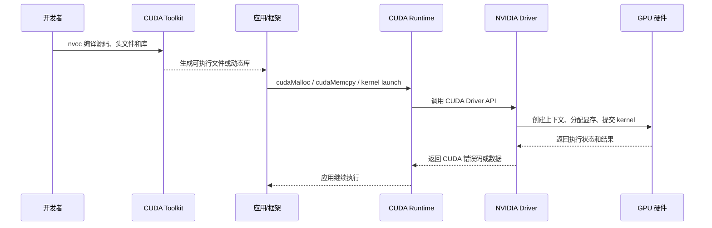

# NVIDIA 显卡驱动与 CUDA Toolkit：关系、作用、安装验证与排障指南

> 适用对象：需要使用 NVIDIA GPU 进行图形渲染、机器学习、科学计算、推理、训练或 Kubernetes GPU 运维的开发者和运维人员。
>
> 核心结论：**NVIDIA 显卡驱动负责让操作系统能够识别、控制和使用 GPU；CUDA Toolkit 负责让开发者编译、链接、调试和分析 CUDA 程序。** 运行一个已经编译好的 CUDA 程序，通常必须有兼容的 GPU 驱动，但不一定需要在宿主机安装完整 CUDA Toolkit。

## 目录

1. [先记住这张关系表](#1-先记住这张关系表)
2. [从硬件到业务的完整软件栈](#2-从硬件到业务的完整软件栈)
3. [NVIDIA 显卡驱动是什么](#3-nvidia-显卡驱动是什么)
4. [CUDA Toolkit 是什么](#4-cuda-toolkit-是什么)
5. [驱动与 Toolkit 如何配合](#5-驱动与-toolkit-如何配合)
6. [Driver API 与 Runtime API](#6-driver-api-与-runtime-api)
7. [版本号和兼容性怎么理解](#7-版本号和兼容性怎么理解)
8. [裸机安装方式与选择](#8-裸机安装方式与选择)
9. [容器中的驱动与 CUDA](#9-容器中的驱动与-cuda)
10. [Kubernetes GPU 节点的关系](#10-kubernetes-gpu-节点的关系)
11. [分层验证 Runbook](#11-分层验证-runbook)
12. [常见故障与排查方法](#12-常见故障与排查方法)
13. [升级、回滚和生产运维](#13-升级回滚和生产运维)
14. [按场景选择安装方案](#14-按场景选择安装方案)
15. [命令速查与术语表](#15-命令速查与术语表)
16. [参考资料](#16-参考资料)

---

## 1. 先记住这张关系表

| 组件 | 主要作用 | 典型文件或命令 | 是否必须安装在宿主机 |
|---|---|---|---|
| NVIDIA GPU 硬件 | 执行图形、通用计算和 CUDA kernel | PCIe/SXM GPU、显存、SM、Tensor Core | 是物理硬件 |
| NVIDIA 显卡驱动 | 让操作系统控制 GPU，提供 CUDA Driver API、显示和计算能力 | `nvidia.ko`、`libcuda.so`、`nvidia-smi`、Windows WDDM 驱动 | 使用 GPU 时必须 |
| CUDA Toolkit | 编译、链接、调试和分析 CUDA 程序 | `nvcc`、头文件、`libcudart.so`、cuBLAS、Nsight、samples | 只有开发或需要本机编译时必须 |
| CUDA Runtime | 给应用提供较易用的 CUDA 运行时接口 | `cudaMalloc`、`cudaMemcpy`、`cudaLaunchKernel` | 应用运行时需要；可由应用、镜像或框架提供 |
| CUDA Driver API | 驱动暴露的底层 API，负责初始化设备、上下文、模块和内存等 | `cuInit`、`cuDeviceGet`、`cuMemAlloc`、`libcuda.so` | 由 NVIDIA 驱动提供 |
| CUDA 应用或框架 | 使用 GPU 完成训练、推理或计算 | PyTorch、TensorFlow、CUDA C++ 程序 | 由业务环境提供 |
| NVIDIA Container Toolkit | 将宿主机 GPU、驱动库和设备注入容器 | `nvidia-container-runtime`、`nvidia-ctk` | 使用 GPU 容器时，安装在节点 |
| Kubernetes Device Plugin / GPU Operator | 把 GPU 注册为 Kubernetes 资源并完成设备注入和运维 | `nvidia.com/gpu`、`gpu-operator` | 使用 Kubernetes GPU 时，安装在集群节点/控制资源中 |

可以用下面这句话判断是否需要安装：

| 需求 | NVIDIA 驱动 | CUDA Toolkit |
|---|---:|---:|
| 桌面显示、视频编码、GPU 图形应用 | 需要 | 不需要 |
| 直接运行别人已经编译好的 CUDA 程序 | 需要 | 通常不需要完整 Toolkit |
| 在本机用 `nvcc` 编译 CUDA C/C++ | 需要 | 需要 |
| 编译需要 CUDA 头文件和开发库的 Python 扩展 | 需要 | 通常需要，具体看构建系统 |
| 运行带 CUDA Runtime 的容器 | 节点需要 | 容器通常带运行库，宿主机不一定需要 Toolkit |
| Kubernetes 调度 GPU Pod | 节点需要 | 通常由镜像或 GPU Operator/节点组件提供运行时 |

### 1.1 最容易记错的三件事

1. **`nvidia-smi` 能正常运行，不代表安装了 CUDA Toolkit。** 它主要检查驱动和 GPU 状态。
2. **`nvidia-smi` 输出的 `CUDA Version`，通常表示当前驱动支持的最高 CUDA 版本，不是本机 `nvcc` 的版本，也不是某个 Python 包编译时使用的版本。**
3. **驱动和 Toolkit 不是同一个东西。** 某些旧版安装包会把驱动作为可选组件一起安装，但概念、升级节奏和运行职责仍然不同。

---

## 2. 从硬件到业务的完整软件栈

### 2.1 分层结构

```text
┌──────────────────────────────────────────────────────────────┐
│ 业务层：PyTorch / TensorFlow / JAX / 自研 CUDA 程序           │
├──────────────────────────────────────────────────────────────┤
│ 高层 GPU 库：cuDNN / NCCL / TensorRT / RAPIDS / 自定义扩展     │
├──────────────────────────────────────────────────────────────┤
│ CUDA Runtime：libcudart、cudaMalloc、cudaMemcpy、kernel 启动   │
├──────────────────────────────────────────────────────────────┤
│ CUDA Driver API：libcuda.so、cuInit、上下文、模块、设备管理   │
├──────────────────────────────────────────────────────────────┤
│ NVIDIA 用户态驱动库：NVML、编解码库、OpenGL/Vulkan/GLX 等      │
├──────────────────────────────────────────────────────────────┤
│ NVIDIA 内核态驱动：nvidia.ko、nvidia-uvm、nvidia-modeset 等    │
├──────────────────────────────────────────────────────────────┤
│ GPU 硬件：SM、Tensor Core、显存、PCIe/NVLink、固件            │
└──────────────────────────────────────────────────────────────┘
```

CUDA Toolkit 主要覆盖中间的开发层和工具层；NVIDIA 驱动覆盖靠近硬件的控制层。cuDNN、NCCL、TensorRT 这类组件属于 NVIDIA GPU 软件生态，常常单独发布，不能简单地等同于 CUDA Toolkit。

### 2.2 一次 CUDA 程序的实际路径



编译阶段主要依赖 Toolkit；运行阶段的关键底座是 GPU、驱动和应用需要的动态库。一个程序可以在没有 `nvcc` 的机器上运行，但不能在没有兼容 NVIDIA 驱动的机器上真正使用 NVIDIA GPU。

---

## 3. NVIDIA 显卡驱动是什么

### 3.1 驱动解决什么问题

显卡驱动是操作系统与 NVIDIA GPU 之间的控制层，主要负责：

- 识别 GPU、初始化设备和加载固件；
- 管理显存、GPU 上下文、命令队列和进程隔离；
- 把 CUDA、OpenGL、Vulkan、Direct3D 等上层请求转换成 GPU 可执行的操作；
- 管理显示输出、图形合成、视频编解码和电源状态；
- 暴露 CUDA Driver API、NVML 等用户态接口；
- 报告温度、功耗、显存、利用率、ECC 和 Xid 等设备状态。

没有驱动时，系统可能仍然能在 PCI 总线上看到设备，但 CUDA 应用无法正常初始化 GPU。看到 `lspci` 里的 NVIDIA 设备，只能证明硬件枚举成功，不能证明驱动已经工作。

### 3.2 Linux 驱动的两部分

Linux 上的 NVIDIA 驱动通常包含内核态模块和用户态组件。

| 部分 | 作用 | 常见例子 |
|---|---|---|
| 内核态模块 | 与 PCI、内存管理、设备文件和 GPU 硬件交互 | `nvidia`、`nvidia_uvm`、`nvidia_modeset`、`nvidia_drm` |
| 用户态驱动库 | 给应用提供 CUDA、NVML、图形和编解码接口 | `libcuda.so`、`libnvidia-ml.so`、OpenGL/Vulkan 库 |
| 管理工具 | 查询和管理设备 | `nvidia-smi`、`nvidia-settings` |
| 构建集成 | 为当前内核编译或加载模块 | DKMS、内核 headers、initramfs |

不同发行版、驱动分支和安装方式的模块名称、库路径可能不同。排障时应以实际 `modinfo`、`ldconfig -p` 和包管理器输出为准。

### 3.3 驱动不等于 Toolkit

驱动一般不提供以下完整开发能力：

- `nvcc` 编译器；
- CUDA C/C++ 头文件；
- 完整的 `libcudart` 开发链接文件；
- CUDA samples、调试器、性能分析器和开发文档；
- 面向开发者的全部数学库和构建工具。

因此，下面两个命令检查的是不同对象：

```bash
# 主要看驱动、GPU 和驱动支持的 CUDA 兼容级别
nvidia-smi

# 主要看 CUDA Toolkit 的编译器版本
nvcc --version
```

---

## 4. CUDA Toolkit 是什么

CUDA Toolkit 是 NVIDIA 提供的 GPU 应用开发工具包，用来编写、编译、链接、调试和分析 CUDA 程序。它不只是一个 `nvcc` 命令，而是一组开发组件。

### 4.1 常见组件

| 组件 | 作用 | 常见名称 |
|---|---|---|
| 编译器 | 将 CUDA C/C++、设备代码和 PTX 编译成可执行代码或目标文件 | `nvcc` |
| 头文件 | 提供 CUDA Runtime、Driver API、设备属性和库接口声明 | `cuda_runtime.h`、`cuda.h` |
| Runtime 开发库 | 提供易用的设备内存、流、事件和 kernel 启动接口 | `libcudart.so` / `cudart.lib` |
| 基础数学库 | 加速线性代数、FFT、稀疏矩阵、随机数等 | cuBLAS、cuFFT、cuSPARSE、cuRAND |
| 并行算法库 | 提供常用的 C++ 并行原语和数据结构 | Thrust、CUB |
| 调试和分析工具 | 检查 kernel、内存、线程和性能瓶颈 | Nsight Systems、Nsight Compute、Compute Sanitizer |
| 示例与文档 | 提供编译运行样例和 API 说明 | CUDA Samples、Programming Guide |
| 构建集成 | 帮助 CMake、Make、IDE 或 Python 扩展找到 CUDA | `CUDAToolkit_ROOT`、`CMAKE_CUDA_COMPILER` |

具体组件会随 CUDA Toolkit 版本、操作系统和安装方式变化。不能把某个旧版安装目录中的文件列表当成所有版本的固定清单。

### 4.2 Toolkit 不等于所有 CUDA 生态组件

下列组件经常与 CUDA 一起出现，但可能是独立下载、独立版本或由框架打包：

| 组件 | 典型用途 | 是否应默认视为 Toolkit 的一部分 |
|---|---|---|
| cuDNN | 深度学习基础算子 | 否，通常单独发布 |
| NCCL | 多 GPU / 多节点集合通信 | 否，通常单独发布 |
| TensorRT | 推理优化和引擎构建 | 否，单独发布 |
| NVIDIA Container Toolkit | 容器设备和驱动注入 | 否，单独发布 |
| GPU Operator | Kubernetes GPU 节点组件编排 | 否，单独发布 |
| PyTorch / TensorFlow | 机器学习框架 | 否，按发行包或容器提供 |

### 4.3 Toolkit 的运行时依赖

一个使用 CUDA Toolkit 编译的程序，运行时可能需要：

1. 与 GPU 架构兼容的 NVIDIA 驱动；
2. 程序自身携带或系统提供的 `libcudart`、cuBLAS 等用户态库；
3. 驱动提供的 `libcuda.so` 和内核模块；
4. 正确的动态链接器搜索路径；
5. 与应用编译选项、GPU 架构和驱动版本匹配的设备代码。

因此，运行时是否需要“完整 Toolkit”取决于应用如何打包。很多官方容器只携带 CUDA Runtime 和应用库，不携带 `nvcc`，仍然可以正常运行训练或推理。

---

## 5. 驱动与 Toolkit 如何配合

### 5.1 编译时与运行时的分工

| 阶段 | 主要动作 | 主要依赖 |
|---|---|---|
| 编译 | `nvcc` 解析 CUDA 源码、编译 host/device 代码、链接库 | CUDA Toolkit、主机 C/C++ 编译器、头文件和开发库 |
| 加载 | 程序加载 CUDA Runtime 和驱动接口 | 动态库路径、应用打包的 runtime、NVIDIA 驱动 |
| 初始化 | 枚举 GPU、创建上下文、检查能力 | NVIDIA 驱动、GPU 硬件 |
| 执行 | 分配显存、拷贝数据、提交 kernel | CUDA Runtime、Driver API、NVIDIA 驱动、GPU |
| 分析 | 采集 kernel 时间、内存访问和调度信息 | Nsight、驱动支持、应用权限 |

可以把它理解为：

```text
Toolkit = 开发工具箱
Driver  = GPU 的操作系统级控制器

Toolkit 负责“把程序做出来”
Driver  负责“让程序在这块 GPU 上跑起来”
```

### 5.2 典型本机开发流程

```bash
# 1. 查看驱动是否能识别 GPU
nvidia-smi

# 2. 查看 Toolkit 编译器
nvcc --version

# 3. 编译示例（示例文件名仅作说明）
nvcc -O2 -arch=sm_80 vector_add.cu -o vector_add

# 4. 运行并观察退出码
./vector_add
echo $?
```

`nvidia-smi` 成功只能证明驱动层基本可用；`nvcc` 成功只能证明编译工具存在；真正的 GPU 计算还需要执行一个能调用 CUDA API 并验证结果的程序。

### 5.3 典型容器流程

```text
宿主机：GPU + NVIDIA Driver + NVIDIA Container Toolkit
                         │
                         ▼ 设备和兼容驱动库注入
容器：CUDA Runtime + cuDNN/NCCL + PyTorch/TensorFlow + 业务代码
```

容器一般不应该复制一套宿主机内核驱动。容器需要的是用户态 CUDA Runtime，节点运行时负责把 GPU 设备和驱动相关库暴露给容器。容器内的 CUDA 版本需要满足宿主驱动的兼容性要求。

---

## 6. Driver API 与 Runtime API

### 6.1 两个 API 的层次

CUDA 有两个经常被混淆的 API 层：

```text
CUDA Runtime API（较易用）
  cudaMalloc / cudaMemcpy / cudaStreamCreate / kernel<<<...>>>
                         │
                         ▼
CUDA Driver API（更底层、控制更细）
  cuInit / cuDeviceGet / cuCtxCreate / cuModuleLoad / cuMemAlloc
                         │
                         ▼
NVIDIA Driver 提供的 libcuda.so / cuda.dll
```

CUDA Runtime API 通常由 Toolkit 提供的 `libcudart` 实现，并在底层调用由 NVIDIA 驱动暴露的 Driver API。Driver API 的动态库来自显卡驱动，而不是简单地来自 `nvcc` 安装目录。

### 6.2 Runtime API 的特点

- 接口更容易上手，适合大多数 CUDA C/C++ 应用；
- 负责较多隐式初始化、上下文和模块管理；
- 常见函数以 `cuda` 开头；
- 应用通常链接 `libcudart`，可以静态或动态链接，取决于构建方式；
- 仍然依赖底层 NVIDIA 驱动才能访问真正的 GPU。

### 6.3 Driver API 的特点

- 控制粒度更细，适合运行时加载模块、管理上下文和高级设备能力；
- 常见函数以 `cu` 开头；
- 直接面对驱动提供的 API 和 ABI；
- 需要更明确地处理上下文、模块、函数和资源生命周期；
- 可以和 Runtime API 互操作，但资源创建和释放应遵守同一 API 的版本与生命周期规则。

### 6.4 运行时库、驱动库和开发库的区别

| 名称 | 典型来源 | 作用 |
|---|---|---|
| `libcuda.so` / `cuda.dll` | NVIDIA 显卡驱动 | Driver API 入口 |
| `libnvidia-ml.so` | NVIDIA 显卡驱动 | NVML，供 `nvidia-smi` 等工具查询管理 |
| `libcudart.so` | CUDA Toolkit 或应用/容器 | Runtime API 实现 |
| `libcublas.so` | CUDA Toolkit 或单独库包 | 线性代数加速 |
| `cuda.h` / `cuda_runtime.h` | CUDA Toolkit | 编译期声明和类型 |

在排查 `libcuda.so` 和 `libcudart.so` 时，不要把两者都归因于“CUDA 没装好”：前者重点看驱动，后者重点看 Toolkit、容器镜像和动态库路径。

---

## 7. 版本号和兼容性怎么理解

### 7.1 至少要记录五类版本

GPU 任务不能只记录一个“CUDA 版本”。建议至少记录：

| 版本维度 | 示例形式 | 影响 |
|---|---|---|
| GPU 型号/架构 | A100、H100、RTX 4090、sm_80 | 支持的指令、显存和 Tensor Core 能力 |
| 驱动版本/分支 | `550.xx`、`R570`、`R580` | 支持的 GPU、CUDA Driver API 和兼容上限 |
| CUDA Toolkit | 12.x、13.x | 编译器、头文件、Runtime 和开发库 |
| 框架构建标签 | `cu118`、`cu121`、`cu124` | 框架二进制使用的 CUDA 用户态库基线 |
| 宿主与运行时 | Linux kernel、containerd、NVIDIA Container Toolkit | 内核模块、设备注入和容器启动能力 |

### 7.2 向后兼容和最低驱动版本

NVIDIA 官方兼容规则可以先记成两条：

1. **较新的驱动通常可以运行使用较旧 CUDA Toolkit 编译的应用。** 这叫驱动对旧 CUDA 应用的向后兼容。
2. **每个 CUDA Toolkit 都有最低驱动版本要求。** 用较新的 Toolkit 编译的应用，不能因为“驱动能识别 GPU”就默认能运行。

CUDA 11 之后，同一 major 家族内还存在 Minor Version Compatibility，但只在指定最低驱动和支持范围内成立，并可能有功能限制。跨 major 的 Forward Compatibility 需要按照官方兼容指南使用 `cuda-compat-*` 等机制，且受 GPU、平台和驱动分支限制。

不要只看下面这种不完整判断：

```text
错误判断：nvidia-smi 显示 CUDA 12.4，所以任何 CUDA 12.x 程序都一定能运行。
```

应改为：

```text
正确方向：确认应用/镜像实际使用的 CUDA 用户态库、目标 GPU 架构、驱动最低版本、
          框架构建标签和是否使用特殊兼容包，再根据官方矩阵判断。
```

### 7.3 “CUDA Version”与 `nvcc` 版本

```bash
$ nvidia-smi
# 其中的 CUDA Version：驱动声明的最高支持 CUDA 版本，偏向驱动兼容能力

$ nvcc --version
# 显示 Toolkit 编译器版本，偏向本机开发环境
```

两者不一致是常见情况，不一定是故障。例如：

- 机器只有驱动，没有 Toolkit：`nvidia-smi` 正常，`nvcc` 不存在；
- 宿主机安装旧 Toolkit，但后来升级了新驱动：两者显示不同；
- 容器里有一套 CUDA Runtime，宿主机 `nvcc` 是另一套版本；
- Python 框架自带或依赖自己的 CUDA 用户态库，命令行输出不能直接代表框架构建版本。

### 7.4 兼容性判断表

| 情况 | 通常结果 | 需要确认 |
|---|---|---|
| 旧 Toolkit 编译的程序 + 较新驱动 | 通常可运行 | GPU 架构、应用是否依赖已移除特性 |
| 新 Toolkit 编译的程序 + 太旧驱动 | 常见启动失败 | 最低驱动版本、兼容包和目标架构 |
| 宿主机有驱动，容器带 CUDA Runtime | 常见生产模式 | Container Toolkit、驱动兼容范围、库挂载 |
| 宿主机有 Toolkit，容器使用另一套 Runtime | 可以，但要谨慎 | `LD_LIBRARY_PATH`、库优先级和 ABI |
| GPU 架构早于 Toolkit 支持范围 | 编译或运行失败 | `-gencode`、`-arch`、PTX 和架构支持矩阵 |

版本升级前应查目标 CUDA Toolkit 的 Release Notes、CUDA Compatibility Guide 和对应 GPU 架构矩阵。本文不固定某个长期有效的版本数字，因为驱动分支和 Toolkit 会继续发布新版本。

---

## 8. 裸机安装方式与选择

### 8.1 三种常见安装目标

#### 只装驱动

适合：

- 图形桌面、视频编解码；
- 只运行别人提供的 GPU 二进制；
- 只把主机作为容器/Kubernetes GPU 节点。

验证重点是 `nvidia-smi`、内核模块、设备文件和简单 GPU smoke test，不要求 `nvcc` 存在。

#### 驱动 + CUDA Toolkit

适合：

- 本机编译 CUDA C/C++；
- 编译 PyTorch/TensorFlow 自定义 CUDA 扩展；
- 使用 Nsight、Compute Sanitizer、CUDA Samples；
- 需要本地编译和调试的研发主机。

#### 节点驱动 + 容器运行时

适合：

- Docker/Podman 运行 CUDA 容器；
- Kubernetes GPU 节点；
- 训练和推理平台。

宿主机通常只维护稳定的驱动与容器运行时，CUDA Toolkit 和应用依赖放进镜像，由镜像版本控制。

### 8.2 安装前检查清单

在执行安装或升级前，先记录以下事实：

```bash
# 硬件枚举
lspci -nn | grep -i nvidia

# 当前驱动（如果已安装）
nvidia-smi || true

# 内核与发行版
uname -a
cat /etc/os-release

# Secure Boot、内核 headers、DKMS 状态按目标发行版检查
mokutil --sb-state 2>/dev/null || true
dkms status 2>/dev/null || true
```

还要确认：

- GPU 架构是否被目标驱动分支支持；
- Linux kernel 是否在驱动支持范围内；
- Secure Boot 是否要求签名内核模块；
- 是否已经安装过发行版驱动、NVIDIA 官方仓库包或 `.run` 安装包；
- 服务器是否运行 Xorg、Wayland、持久化服务或其他 GPU 作业；
- 驱动升级后的重启窗口和回滚包是否准备好。

### 8.3 包管理器与 runfile 的取舍

| 方式 | 优点 | 主要风险 |
|---|---|---|
| 发行版包 | 与内核和系统升级集成较好 | 版本可能较旧，命名因发行版不同 |
| NVIDIA 官方仓库 | 版本可控，适合标准化节点 | 需要维护仓库、密钥和包依赖 |
| `.run` 安装包 | 版本直接、适合特定环境 | 容易与包管理器冲突，升级和卸载复杂 |
| GPU Operator | 适合 Kubernetes 声明式管理 | 依赖集群版本、节点条件和 Operator 兼容性 |

同一台生产主机不要无规划地混用发行版包、官方仓库包和 `.run` 包。已经混装时，先用包清单、`modinfo`、`ldconfig -p` 和安装日志确认当前来源，再决定清理或迁移方案。

### 8.4 Windows 与 WSL 的边界

- Windows 使用 WDDM 驱动，桌面显示与计算共享驱动体系；
- WSL2 的 GPU 加速由 Windows 主机驱动和 WSL GPU 接口协作完成；
- WSL 内通常不按普通 Linux 主机方式重复安装完整内核驱动；
- Windows、WSL、容器和框架的兼容性必须按目标版本官方文档确认；
- 不要把“Linux 服务器安装步骤”原样套用到 Windows 主机或 WSL。

---

## 9. 容器中的驱动与 CUDA

### 9.1 推荐的职责边界

```text
宿主机负责：
  GPU 硬件、内核驱动、用户态驱动库、NVIDIA Container Toolkit、容器运行时

容器负责：
  CUDA Runtime、cuDNN/NCCL/TensorRT、框架、业务代码和应用配置
```

容器内不要把宿主机的 `nvidia.ko` 内核模块复制进去。内核模块只能由宿主机内核加载，容器只能通过运行时获得设备和用户态库访问。

### 9.2 Docker 最小验证

以下命令是验证路径示例，镜像 tag 应替换成已经批准并与驱动兼容的版本：

```bash
# 节点侧先确认驱动
nvidia-smi

# 容器侧只验证 GPU 设备和驱动注入
docker run --rm --gpus all \
  nvidia/cuda:<approved-tag> nvidia-smi
```

这个命令成功，说明容器可以看到 GPU 和 `nvidia-smi`，但还不能证明 PyTorch、NCCL 或业务训练成功。还要执行与业务相同的框架导入、设备初始化和最小计算。

### 9.3 容器中常见的版本误区

| 误区 | 更准确的理解 |
|---|---|
| “容器 CUDA 版本必须和宿主机 Toolkit 一样” | 宿主机 Toolkit 可能根本不存在；重点是容器 Runtime 与宿主驱动兼容 |
| “镜像里装了驱动就能用 GPU” | 内核驱动必须在宿主机；镜像内驱动容易与宿主机冲突 |
| “`nvidia-smi` 成功就代表训练成功” | 只证明设备注入和基本查询成功，未证明框架、通信和业务逻辑 |
| “只要有 `--gpus all` 就一定能用” | 还需要 NVIDIA Container Toolkit、运行时配置和权限正确 |
| “把宿主机 `/usr/local/cuda` 挂进所有容器” | 可能覆盖镜像库，造成 ABI、版本或库搜索顺序冲突 |

### 9.4 Singularity / Apptainer

HPC 场景通常使用：

```bash
apptainer exec --nv cuda-app.sif nvidia-smi
```

`--nv` 的作用是把宿主机 GPU 设备和驱动相关库暴露给容器。容器镜像仍应携带应用需要的 CUDA Runtime。更完整的 HPC 容器说明见：[Singularity / Apptainer HPC 容器平台详解](../容器编排/Singularity-HPC容器平台详解.md)。

---

## 10. Kubernetes GPU 节点的关系

### 10.1 GPU Pod 的完整路径

```text
GPU 硬件
  ↓
节点 NVIDIA Driver
  ↓
NVIDIA Container Toolkit / containerd runtime
  ↓
NVIDIA Device Plugin 或 GPU Operator
  ↓
Node.status.allocatable：nvidia.com/gpu
  ↓
调度器放置 Pod
  ↓
Device Plugin Allocate 注入设备、环境变量和挂载
  ↓
Pod 内 CUDA Runtime / 框架 / 业务代码
```

### 10.2 Kubernetes 中的四层验收

| 层级 | 要证明什么 | 典型证据 |
|---|---|---|
| 节点硬件 | 节点确实有目标 GPU | `lspci`、BMC/硬件清单 |
| 驱动 | 节点能初始化 GPU | 节点 `nvidia-smi`、驱动 Pod 日志 |
| 资源注册 | Kubernetes 看到了可分配 GPU | `Capacity/Allocatable` 中的 `nvidia.com/gpu` |
| 容器与业务 | Pod 能通过 CUDA 完成真实计算 | Pod 内 `nvidia-smi`、框架设备检查、业务 smoke test |

`PodScheduled=True` 只说明调度器找到了一个满足资源声明的节点；它不等于设备已经注入，更不等于 CUDA 业务成功。这个边界和 Kubernetes 中其他资源一样，需要分别验证。

### 10.3 只读检查命令

```bash
GPU_NS=<gpu-system-namespace>
GPU_NODE=<gpu-node-name>

# 节点资源
kubectl describe node "$GPU_NODE" | grep -A8 -B2 -i 'nvidia.com/gpu'

# GPU 相关组件
kubectl -n "$GPU_NS" get pods -o wide
kubectl -n "$GPU_NS" get daemonset

# Pod 事件与日志
kubectl -n <workload-namespace> describe pod <pod-name>
kubectl -n "$GPU_NS" logs <device-plugin-pod> --all-containers
```

上面使用了占位符，执行前应明确替换 Namespace、节点名和 Pod 名称；不应直接复制未知环境的资源名。

### 10.4 最小 GPU smoke Pod

```yaml
apiVersion: v1
kind: Pod
metadata:
  name: gpu-smoke
  namespace: <test-namespace>
spec:
  restartPolicy: Never
  containers:
    - name: cuda
      image: nvidia/cuda:<approved-tag>
      command: ["bash", "-lc"]
      args:
        - nvidia-smi && sleep 2
      resources:
        limits:
          nvidia.com/gpu: 1
```

验收顺序：

1. `kubectl get pod -n <test-namespace> -w` 观察调度和启动；
2. `kubectl describe pod` 查看是否是 `Insufficient nvidia.com/gpu`、镜像拉取或运行时错误；
3. `kubectl logs` 确认 `nvidia-smi` 输出；
4. 再用实际框架做设备初始化和最小矩阵计算；
5. 最后才把结果当成业务 GPU 可用。

MIG、Time-Slicing、MPS、vGPU 和 DRA 会改变资源名称、隔离边界或分配方式，不能只凭 `nvidia.com/gpu` 一个资源名判断所有 GPU 形态。Kubernetes GPU 生态的详细笔记见：[K8s 多集群与进阶生态](../容器编排/K8s-多集群与进阶生态.md)。

---

## 11. 分层验证 Runbook

### 11.1 先收集版本和环境

```bash
date -Is
hostname
uname -a
cat /etc/os-release

# GPU、驱动和进程状态
lspci -nn | grep -i nvidia
nvidia-smi
nvidia-smi -q 2>/dev/null | head -200

# Toolkit
command -v nvcc || true
nvcc --version 2>/dev/null || true
readlink -f /usr/local/cuda 2>/dev/null || true
cat /usr/local/cuda/version.json 2>/dev/null || true
```

注意：`nvidia-smi -q` 输出可能包含序列号、UUID、进程名等信息。发给外部人员前应按安全要求脱敏。

### 11.2 硬件与内核模块层

```bash
# PCI 设备和绑定的驱动
lspci -nnk | grep -A4 -i nvidia

# 内核模块是否加载
lsmod | grep '^nvidia'
modinfo nvidia 2>/dev/null | sed -n '1,40p'

# 内核日志中的 GPU/Xid/模块错误
dmesg -T | grep -Ei 'nvrm|xid|nvidia|gpu' | tail -100

# 设备文件
ls -l /dev/nvidia* 2>/dev/null
```

事实判断：

- `lspci` 无设备：先查硬件、BIOS、PCIe、虚拟机直通或云实例类型；
- `lspci` 有设备但 `lsmod` 无模块：驱动未加载、模块构建失败或 Secure Boot 阻止加载；
- 模块有但 `nvidia-smi` 失败：继续查用户态库、设备文件、权限和驱动日志；
- 出现 Xid：需要结合时间、GPU、进程和应用日志判断，不能只把它归结为 Toolkit 版本。

### 11.3 驱动用户态层

```bash
nvidia-smi

# 查询 NVML 和 CUDA Driver API 的库来源
ldconfig -p 2>/dev/null | grep -E 'libcuda|libnvidia-ml'
find /usr -name 'libcuda.so*' -o -name 'libnvidia-ml.so*' 2>/dev/null | head -50

# 检查驱动包来源（按发行版选择其一）
dpkg -l 2>/dev/null | grep -i nvidia | head -80
rpm -qa 2>/dev/null | grep -i nvidia | head -80
```

`nvidia-smi` 报 `Driver/library version mismatch` 时，优先判断内核已加载的驱动版本和用户态库版本是否来自同一套安装；不要直接通过修改 `LD_LIBRARY_PATH` 把另一套库强行放到前面。

### 11.4 Toolkit 与开发层

```bash
command -v nvcc
nvcc --version

# 查看 nvcc 实际路径和可能的软链接
readlink -f "$(command -v nvcc)" 2>/dev/null || true

# 只读查看系统中可能存在的 Toolkit 目录
find /usr/local -maxdepth 2 -type d -name 'cuda*' 2>/dev/null | sort

# 检查 CMake 发现的 CUDA 编译器（如果项目使用 CMake）
cmake -S . -B build -LA 2>/dev/null | grep -Ei 'CUDA|CMAKE_CUDA' || true
```

`nvcc` 不存在不等于 GPU 不能用，只说明本机没有可执行的 Toolkit 编译器，或者没有配置 PATH。要先明确当前目标是“运行”还是“开发”。

### 11.5 动态库和最小程序层

```bash
# 查看应用依赖的动态库
ldd ./your_cuda_app | grep -Ei 'cuda|cudart|cublas|cudnn|nccl|not found'

# 检查动态库搜索配置
echo "$LD_LIBRARY_PATH"
ldconfig -p 2>/dev/null | grep -E 'libcudart|libcublas|libcudnn|libnccl'
```

然后运行一个能验证以下内容的最小程序：

- `cudaGetDeviceCount` 返回目标 GPU 数量；
- `cudaGetDeviceProperties` 返回预期型号和计算能力；
- 成功分配和释放显存；
- 完成一次 Host ↔ Device 拷贝；
- 启动一个简单 kernel 并校验结果；
- 程序退出时 `cudaGetLastError` / `cudaDeviceSynchronize` 没有错误。

### 11.6 Python 框架层

以 PyTorch 为例，下面只说明检查思路：

```bash
python3 - <<'PY'
import sys

print("python:", sys.version)
try:
    import torch
    print("torch:", torch.__version__)
    print("torch.version.cuda:", torch.version.cuda)
    print("cuda available:", torch.cuda.is_available())
    if torch.cuda.is_available():
        print("device count:", torch.cuda.device_count())
        print("device 0:", torch.cuda.get_device_name(0))
        x = torch.ones((2, 2), device="cuda")
        print("smoke result:", (x @ x).tolist())
except Exception as exc:
    print(type(exc).__name__ + ":", exc)
    raise
PY
```

这个检查比只看 `torch.version.cuda` 更有价值，因为它实际验证了导入、驱动初始化、设备分配和一次 GPU 计算。仍然要结合业务模型、显存规模、NCCL 和多进程通信做完整验收。

### 11.7 证据边界

| 证据 | 能证明 | 不能证明 |
|---|---|---|
| `lspci` 有 NVIDIA 设备 | PCI 枚举成功 | 驱动已加载、CUDA 可用 |
| `nvidia-smi` 成功 | 驱动和 NVML 基本可用 | Toolkit、框架或训练成功 |
| `nvcc --version` 成功 | Toolkit 编译器可执行 | 运行时驱动兼容、GPU 计算正确 |
| `docker run ... nvidia-smi` 成功 | GPU 设备和驱动注入 | 框架、NCCL 和业务成功 |
| Pod `Running` / `Ready` | 容器进程和探针满足条件 | GPU kernel 或训练逻辑成功 |
| Python `torch.cuda.is_available()` 为真 | 框架能初始化 GPU | 模型可训练、显存足够、多卡通信正常 |
| 训练任务完成 | 该任务在该配置下完成 | 其他镜像、GPU、数据规模一定可用 |

---

## 12. 常见故障与排查方法

| 症状 | 已确认事实 | 基于证据的判断 | 建议检查 |
|---|---|---|---|
| `nvidia-smi: command not found` | 管理命令不在 PATH 或未安装 | 可能未装驱动，也可能只缺工具包 | `command -v nvidia-smi`、包清单、`lspci` |
| `No devices were found` | NVML 没发现可用 GPU | 硬件、驱动加载、设备权限或虚拟化链路有问题 | `lspci -nnk`、`lsmod`、`/dev/nvidia*`、`dmesg` |
| `Failed to initialize NVML` | `nvidia-smi` 无法初始化 NVML | 驱动模块和用户态库不匹配、模块失败或权限异常 | `modinfo`、`ldconfig -p`、包来源、重启记录 |
| `Driver/library version mismatch` | 内核驱动和用户态库版本不同 | 混装、升级后未重启或库路径指向旧版本 | `cat /proc/driver/nvidia/version`、`nvidia-smi`、`ldconfig` |
| `nvcc: command not found` | Toolkit 编译器不存在或不在 PATH | 驱动可能正常，开发工具未安装/未配置 | `find /usr/local -name nvcc`、PATH、Toolkit 包 |
| `cuda_runtime.h: No such file` | 编译器找不到 Toolkit 头文件 | Toolkit 未安装、路径错或构建环境不完整 | `CUDA_HOME`、include 路径、CMake 配置 |
| `libcudart.so: cannot open` | 运行时找不到 CUDA Runtime | 库未安装、未打包或 `LD_LIBRARY_PATH`/rpath 不对 | `ldd`、`ldconfig -p`、镜像层和启动脚本 |
| `CUDA driver version is insufficient` | 应用需要的 Driver API 能力高于当前驱动 | 驱动太旧或框架/镜像 CUDA 版本过新 | 查 Toolkit/框架最低驱动和官方兼容矩阵 |
| `no kernel image is available` | 当前二进制没有适配这块 GPU 的代码 | `-arch`/`-gencode` 缺少目标架构，或架构已不支持 | GPU Compute Capability、编译参数、PTX |
| `unsupported toolchain` | CUDA 编译器拒绝当前 host compiler | GCC/Clang 版本不在 Toolkit 支持范围 | Toolkit Release Notes、host compiler 版本 |
| `CUDA out of memory` | GPU 显存分配失败 | batch、模型、缓存或共享 GPU 占用超过显存 | `nvidia-smi`、框架显存统计、批大小和并发 |
| 容器内 `nvidia-smi` 失败 | GPU 没有正确注入容器 | Container Toolkit、runtime 配置或节点驱动问题 | 宿主 `nvidia-smi`、runtime、容器日志 |
| K8s `Pending: Insufficient nvidia.com/gpu` | 调度器没有找到可用扩展资源 | 资源被占满、Device Plugin 未上报、MIG 资源名错误 | `kubectl describe node`、事件、Device Plugin |
| K8s Pod 已启动但 CUDA 失败 | 调度成功但运行时初始化失败 | 设备注入、驱动兼容或镜像库有问题 | Pod 内 `nvidia-smi`、`ldd`、框架 smoke test |
| 多卡单卡正常，多卡失败 | 单卡路径可用 | NCCL、拓扑、网络、进程 rank 或端口存在问题 | NCCL 日志、GPU 拓扑、`MASTER_ADDR/PORT`、网卡 |

### 12.1 `nvidia-smi` 正常但程序失败

按顺序分层：

1. 应用是否真的在使用 NVIDIA GPU，而不是 CPU fallback；
2. 应用加载的是哪一份 `libcudart`、cuDNN、NCCL；
3. 驱动是否满足应用构建的最低版本；
4. GPU 架构是否被应用二进制支持；
5. 显存、权限、MIG 配置和进程数量是否满足要求；
6. 单卡最小计算是否成功，再判断多卡和业务数据问题。

### 12.2 `CUDA out of memory` 与容器 OOMKilled

两者不是同一个资源：

- `CUDA out of memory`：GPU 显存分配失败，通常由模型、batch、缓存或 GPU 共享导致；
- `OOMKilled`：Linux cgroup 的系统内存限制触发，通常看 Pod `lastState`, `reason` 和节点内存；
- 一个任务可能同时遇到 GPU 显存不足和系统内存不足，必须分别收集证据。

### 12.3 不要用“重新安装 Toolkit”解决所有问题

如果问题是：

- `nvidia-smi` 失败：优先查驱动、内核模块、设备文件和用户态库；
- `nvcc` 不存在：才查 Toolkit、PATH 和开发包；
- 容器启动失败：查 Container Toolkit 和 runtime 配置；
- K8s Pending：查扩展资源、Device Plugin 和调度条件；
- 训练多卡超时：查 rank、网络和 NCCL；

直接重装 Toolkit 可能不会改变真正故障层，还可能引入新的库混装。

---

## 13. 升级、回滚和生产运维

### 13.1 升级前记录

```bash
nvidia-smi > /tmp/nvidia-smi.before.txt
nvidia-smi -q > /tmp/nvidia-smi-q.before.txt
uname -a > /tmp/uname.before.txt
lsmod | grep '^nvidia' > /tmp/nvidia-modules.before.txt
ldconfig -p 2>/dev/null | grep -E 'libcuda|libcudart|libnvidia-ml' \
  > /tmp/nvidia-libs.before.txt
```

生产环境不要把临时目录中的原始输出直接上传到公共位置；其中可能包含 GPU UUID、主机名、进程名或其他环境信息。

还应记录：

- GPU 型号、架构、数量和 MIG/虚拟化状态；
- 当前驱动分支和安装来源；
- 当前 Toolkit、框架和容器镜像 digest；
- 运行中的训练、推理、图形和监控进程；
- DKMS、Secure Boot、内核版本和重启计划；
- 旧驱动包、旧镜像和回滚步骤。

### 13.2 Kubernetes 节点升级顺序

建议在测试节点先完成以下步骤：

1. 记录节点和 GPU 现状；
2. 迁移或停止可中断 GPU 工作负载；
3. 按集群管理方式 cordon/drain 节点；
4. 升级驱动、内核模块或 GPU Operator 管理的 Driver；
5. 重启并验证 `nvidia-smi`、Device Plugin 和 `nvidia.com/gpu`；
6. 使用与生产一致的镜像运行 GPU smoke Pod；
7. 执行框架和多卡通信验证；
8. 恢复节点调度并观察 Xid、Pod 重启、显存和利用率。

驱动、Toolkit、框架和镜像不要在同一个窗口同时无记录地升级。分阶段变更才能判断哪一层改变导致行为变化。

### 13.3 运行期监控

生产节点至少应关注：

- GPU 利用率、显存使用率和显存 ECC 错误；
- 温度、功耗、风扇或散热状态；
- Xid、GPU reset、掉卡和 PCIe 错误；
- 每个进程的 GPU 显存和运行时间；
- Pod 的 GPU 请求、实际使用、重启和调度等待；
- 多 GPU 拓扑、NVLink 或 InfiniBand/RDMA 错误；
- DCGM、Node Exporter、Kubernetes 事件和业务指标。

单次 `nvidia-smi` 成功只是一项瞬时检查，不能替代持续监控和业务级验收。

---

## 14. 按场景选择安装方案

| 场景 | 节点/主机 | 容器或应用 | 是否装完整 Toolkit |
|---|---|---|---:|
| 图形工作站 | 驱动 + 显示栈 | 桌面应用 | 否 |
| 运行预编译推理程序 | 驱动 | 程序自带所需 runtime | 通常否 |
| CUDA C++ 开发机 | 驱动 | 本机源码和构建工具 | 是 |
| PyTorch 训练容器 | 驱动 + Container Toolkit | 镜像带框架和 CUDA runtime | 宿主通常否 |
| Kubernetes GPU 平台 | 驱动 + Toolkit/Operator + Device Plugin | GPU 镜像和业务 | 按 Operator/镜像方案决定 |
| HPC Apptainer 集群 | 驱动 + `libnvidia-container`/集成组件 | SIF 带应用 runtime | 用户节点通常不需要完整 Toolkit |
| 多租户 GPU 平台 | 稳定驱动、隔离和监控 | 经过批准的镜像 | 以镜像和构建系统为准 |

可以使用下面的决策顺序：

```text
是否需要本机编译 CUDA？
├─ 是：驱动 + CUDA Toolkit + host compiler
└─ 否：是否运行 GPU 容器？
    ├─ 是：驱动 + NVIDIA Container Toolkit，CUDA runtime 放进镜像
    └─ 否：只装满足应用的驱动和必要用户态组件
```

---

## 15. 命令速查与术语表

### 15.1 命令速查

| 目的 | 命令 |
|---|---|
| 查看 GPU 和驱动 | `nvidia-smi` |
| 查看详细设备信息 | `nvidia-smi -q` |
| 持续观察状态 | `nvidia-smi dmon` |
| 查看进程占用 | `nvidia-smi pmon` 或 `nvidia-smi` |
| 查看 PCI 设备和驱动绑定 | `lspci -nnk` |
| 查看内核模块 | `lsmod` |
| 查看模块信息 | `modinfo nvidia` |
| 查看 Toolkit 编译器 | `nvcc --version` |
| 查找 CUDA 编译器 | `command -v nvcc` |
| 查看 CUDA 动态库 | `ldconfig -p` |
| 检查应用动态库 | `ldd <program>` |
| Docker GPU smoke | `docker run --rm --gpus all <image> nvidia-smi` |
| K8s 节点 GPU 资源 | `kubectl describe node <node>` |
| K8s GPU 组件 | `kubectl -n <gpu-namespace> get pods -o wide` |

### 15.2 术语表

| 术语 | 含义 |
|---|---|
| CUDA | NVIDIA 的 GPU 通用计算平台、编程模型和软件生态总称 |
| CUDA Toolkit | CUDA 应用开发工具包 |
| CUDA Runtime API | 较易用的 CUDA 运行时接口，常见函数以 `cuda` 开头 |
| CUDA Driver API | 更底层的驱动接口，常见函数以 `cu` 开头 |
| NVML | NVIDIA Management Library，`nvidia-smi` 使用的管理接口之一 |
| PTX | NVIDIA GPU 的虚拟指令集，供后续 JIT 或架构编译使用 |
| Compute Capability | GPU 计算能力版本，例如 8.0、8.9、9.0 |
| SM / Streaming Multiprocessor | GPU 中执行线程块和 kernel 的计算单元 |
| `libcuda.so` | 驱动提供的 CUDA Driver API 动态库入口 |
| `libcudart.so` | CUDA Runtime API 的用户态运行库 |
| MIG | Multi-Instance GPU，把特定数据中心 GPU 划分为隔离实例 |
| Device Plugin | Kubernetes 设备插件，将外部设备注册为扩展资源 |
| GPU Operator | NVIDIA 用于 Kubernetes GPU 驱动、工具链和组件管理的 Operator |
| Xid | NVIDIA 驱动报告的 GPU 错误事件编号 |
| DCGM | NVIDIA Data Center GPU Manager，用于数据中心 GPU 监控和管理 |

---

## 16. 参考资料

以下链接来自 NVIDIA 官方文档；具体版本、最低驱动和支持矩阵应以目标版本 Release Notes 为准。

- [CUDA Programming Guide：CUDA Platform](https://docs.nvidia.com/cuda/cuda-programming-guide/01-introduction/cuda-platform.html)
- [CUDA Programming Guide：CUDA Driver API](https://docs.nvidia.com/cuda/cuda-programming-guide/03-advanced/driver-api.html)
- [CUDA Compatibility Guide](https://docs.nvidia.com/deploy/cuda-compatibility/latest/)
- [Why CUDA Compatibility](https://docs.nvidia.com/deploy/cuda-compatibility/latest/why-cuda-compatibility.html)
- [CUDA Toolkit、Driver 与 Architecture Matrix](https://docs.nvidia.com/datacenter/tesla/drivers/latest/cuda-toolkit-driver-and-architecture-matrix.html)
- [CUDA Toolkit Release Notes](https://docs.nvidia.com/cuda/cuda-toolkit-release-notes/index.html)
- [NVIDIA Container Toolkit Documentation](https://docs.nvidia.com/datacenter/cloud-native/container-toolkit/latest/)
- [NVIDIA GPU Operator Documentation](https://docs.nvidia.com/datacenter/cloud-native/gpu-operator/latest/)

### 最终检查清单

- [ ] 已确认 GPU 型号、架构、数量和使用场景。
- [ ] 已区分驱动版本、Toolkit 版本、框架 `cuXXX` 标签和镜像版本。
- [ ] 只运行预编译程序时，没有把“必须装完整 Toolkit”当成前提。
- [ ] 开发编译时，已安装 Toolkit、host compiler 和目标架构支持。
- [ ] 容器节点已验证宿主驱动、Container Toolkit 和 GPU 设备注入。
- [ ] Kubernetes 已分别验收节点驱动、扩展资源、Pod 注入和真实计算。
- [ ] 已查目标 Toolkit Release Notes 和官方兼容矩阵。
- [ ] 已记录升级前版本、安装来源、回滚包和重启窗口。
- [ ] 已把 `nvidia-smi`、`nvcc`、框架 smoke test 和业务验收分开记录。
